<p align="center">
  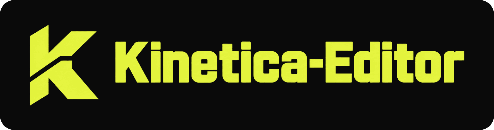
</p>

<p align="center"><b>Редактор робототехники: собрать робота, оживить физикой, записать и повторить — руками, кодом или ИИ-агентом</b></p>

<p align="center">
  <a href="https://github.com/Kinetica-Labs/kinetica-editor/releases/latest">Скачать</a> ·
  <a href="https://kinetica-labs.github.io/kinetica-docs/">Руководство в картинках · Guide</a> ·
  <a href="CONTRIBUTING.md">Писать для Kinetica</a> ·
  <a href="docs/contracts/README.md">Контракты и плагины</a>
</p>

<p align="center">
  <a href="https://kinetica-labs.github.io/kinetica-docs/">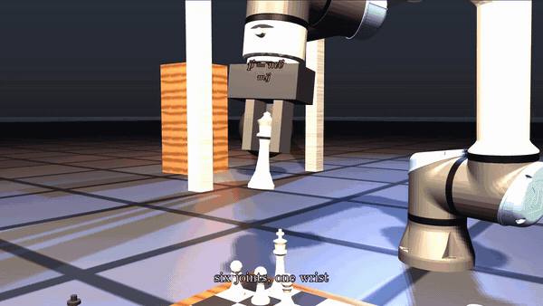</a><br>
  <sub>▶ <a href="https://kinetica-labs.github.io/kinetica-docs/">Фильм целиком, 29 с</a> — сцена плагина <a href="https://github.com/Kinetica-Labs/kinetica-plugins/tree/main/showcase">showcase</a>, снятая самим редактором</sub>
</p>

# Kinetica Editor

Руководство с картинками, на русском и английском — **<https://kinetica-labs.github.io/kinetica-docs/>**;
здесь — исходный код и справочные документы.

Редактор робототехники на C++17 и Qt 6: рука-манипулятор, дрон, колёсный робот, их суставы, приводы и
неидеальные датчики (энкодеры, IMU, сонар, стереокамера). Физика твёрдых тел — готовый движок
[Box3D](https://github.com/erincatto/box3d) за тонкой границей `src/physics/PhysicsWorld.h`
([docs/box3d-backend.md](docs/box3d-backend.md)).

Каждое действие в окне — операция API и строка Python в консоли: то же самое делают скрипт и ИИ-агент
по сети (`--api`, MCP). **Скрипты** — сцена кодом: файл Python строит или меняет сцену и
заканчивается («Файл → Выполнить скрипт…», `--script`; примеры — `examples/scripts/`, руководство —
[docs/scripts.md](docs/scripts.md)). **Плагины** остаются в редакторе и дают ему новые умения: один файл на
Python, `@command` становится кнопкой, строкой консоли и инструментом MCP для ИИ-агента; сохранили —
перезапустился ([docs/plugins.md](docs/plugins.md), контракты — [docs/contracts](docs/contracts/README.md)).
Плагины проекта — в отдельном репозитории kinetica-plugins.

Вторая программа — `kinetica-core`, та же сцена и те же операции без окна: `ke.Scene()` в Python
(`python3 examples/python/01_hello.py` — первая из девяти ступеней: от падающего куба до дрона и анимации, `docs/scripts.md`) или `ke::Scene` в C++ (`examples/cpp/hello.cpp`); начать с неё —
[docs/scripts.md](docs/scripts.md), «Без окна».

Состояние: готовы ядро, модель сцены робота, физика на Box3D, мир робота с суставами, приводами, датчиками и питанием, ИК,
окно редактора, плагины, импорт URDF и glTF. Пример — UR5e с целью ИК, схватом и кубиками (`examples/scenes/ur5e.kscene`).

## Как это выглядит

Окно — девять групп: 1 создание («Фигура», «Свет», «Камера»), 2 запуск («Пуск», «Запись», «Пауза», «Стоп»),
3 что действует на тело («Магнит», «Сила», «Датчик»), 4 «Отменить» и «Повторить», 5 полка инструментов слева, 6 3D-вид, 7 инспектор справа,
8 нижняя панель (секвенсор, графики, консоль), 9 «Примеры», «Лаборатория», «Графики» справа вверху.

<table>
<tr>
<td width="50%" valign="top">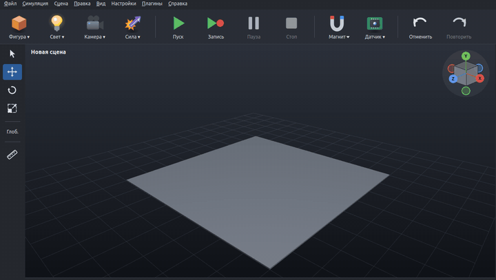<br><b>1 · Фигура мышью.</b> «Фигура ▾» → «Куб» → протянуть основание по полу → поднять высоту, щелчок → «Перемещение» → тянуть стрелку X: подпись говорит, на сколько.</td>
<td width="50%" valign="top">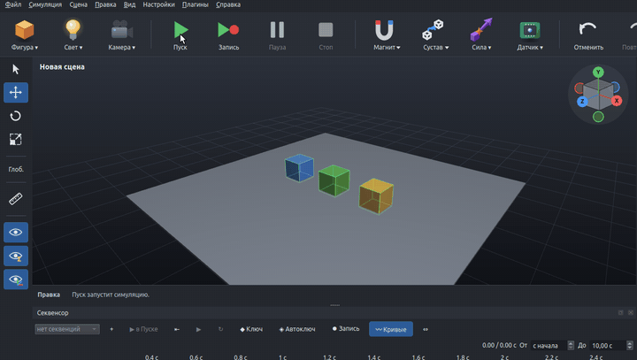<br><b>1 · Свет и сила.</b> «Свет ▾» → «Прожектор»: щелчок — где стоит, второй — высота, третий — куда светит → выбрать куб → «Сила ▾» → «Толчок»: стрелка на кубе → «Пуск»: куб подброшен.</td>
</tr>
<tr>
<td valign="top">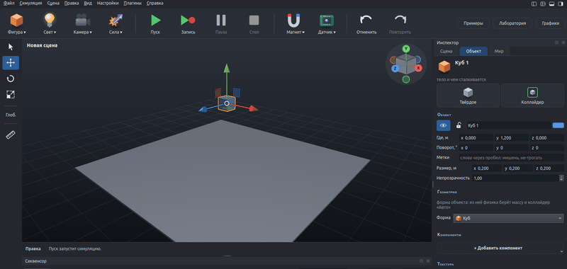<br><b>2 · «Пуск» и «Стоп».</b> Куб в воздухе → плитка «Твёрдое» в инспекторе → «Пуск»: куб падает, рамка вида и верхняя панель зелёные → «Стоп»: куб снова там, где стоял.</td>
<td valign="top">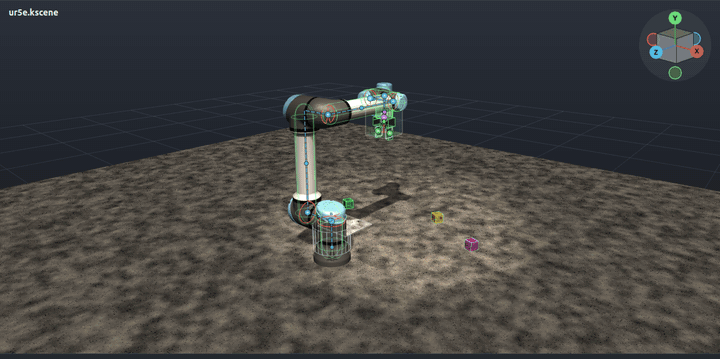<br><b>2 · Робот в игре.</b> Пример UR5e → «Пуск» → D, W, F, A ведут цель схвата, рука идёт за ней по ИК → пробел смыкает схват (здесь мимо кубика).</td>
</tr>
<tr>
<td valign="top">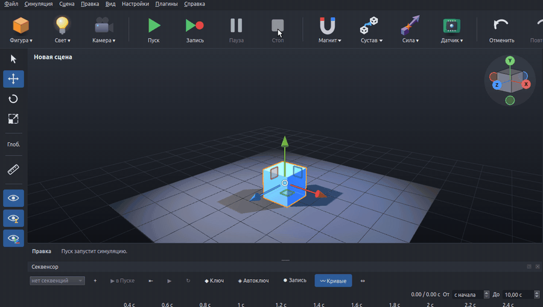<br><b>3 · Магнит и датчик.</b> «Магнит» → навести на грань: призрак звена → щелчок: звено на шарнире → ещё щелчок по новому звену → Esc → «Датчик ▾» → «IMU» на выбранное звено.</td>
<td valign="top">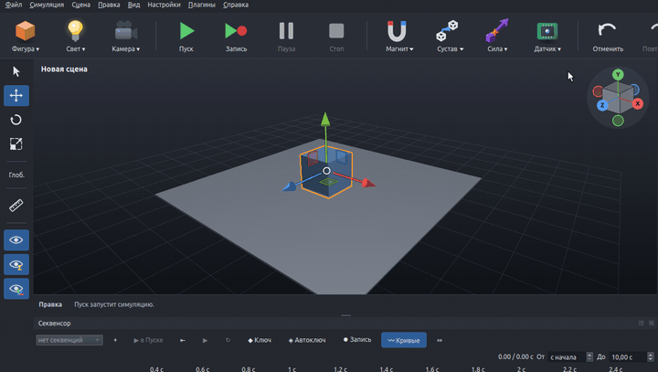<br><b>4 · Отменить и повторить.</b> Стрелка везёт куб → «Отменить»: куб на прежнем месте → «Повторить»: снова там. Шаг отмены — любая правка: из окна, консоли или по сети.</td>
</tr>
<tr>
<td valign="top">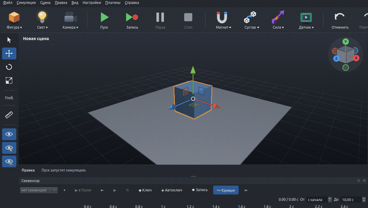<br><b>5 · Полка инструментов.</b> «Вращение» — тянуть кольцо → «Масштаб» — тянуть ручку оси → «Линейка» — протянуть по полу: длина над линией.</td>
<td valign="top">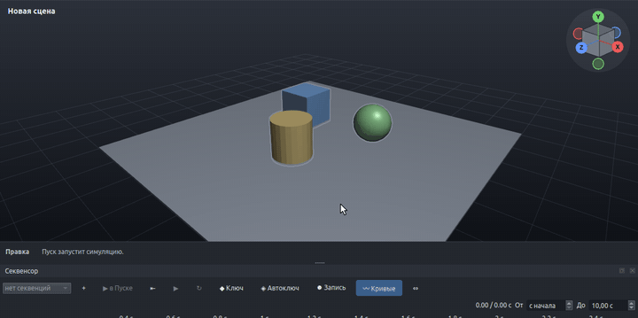<br><b>6 · 3D-вид мышью.</b> Правая кнопка вращает вид → средняя сдвигает → колесо приближает → щелчок по цилиндру и F: вид на нём.</td>
</tr>
<tr>
<td valign="top">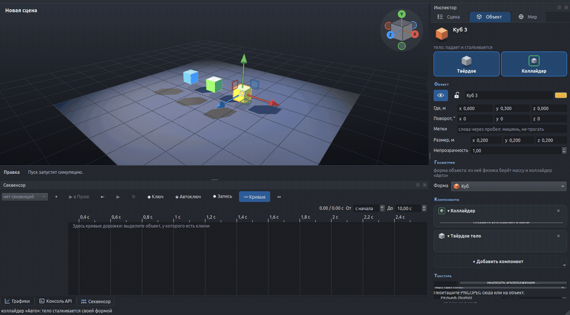<br><b>7 · Инспектор.</b> «Сцена»: щелчок по строке выбирает объект → «Объект»: роли, место, размер, компоненты → коллайдер «Сфера» → «Мир»: настройки мира.</td>
<td valign="top">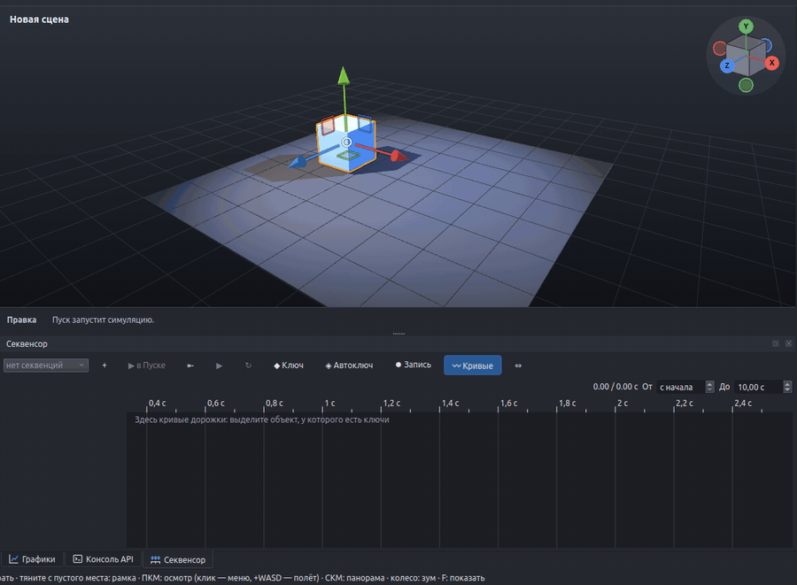<br><b>8 · Ключи в секвенсоре.</b> «◆ Ключ» в 0 с → бегунок на 2 с → стрелка везёт куб → «◆ Ключ» → тянуть бегунок назад и вперёд: куб идёт по дорожке → «▶ Просмотр».</td>
</tr>
<tr>
<td valign="top">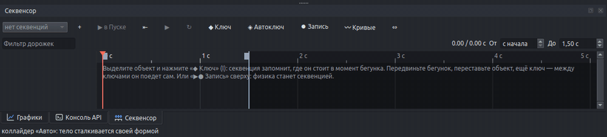<br><b>8 · Запись физики.</b> «Запись» → падение пишется до «До» (1,5 с), сцена встаёт на паузу → «Стоп»: дубль «Запись 1» в секвенсоре → «Кривые» → колесо приближает время.</td>
<td valign="top">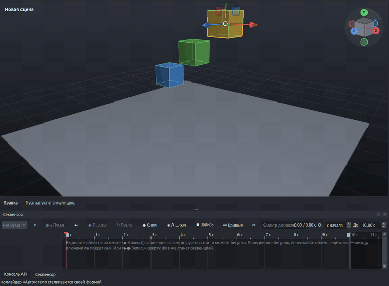<br><b>8 · Графики.</b> «Графики» → «Пуск»: энергия сцены, высота и скорость выбранного куба рисуются, пока идёт игра → «Стоп».</td>
</tr>
<tr>
<td valign="top">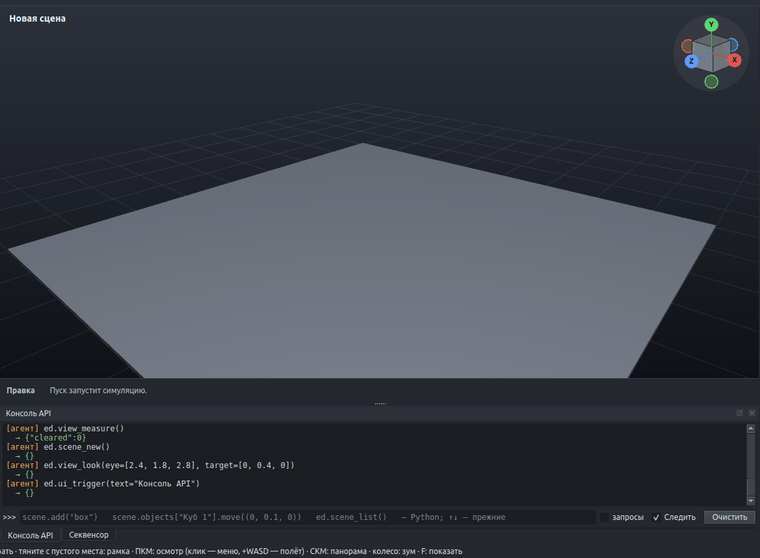<br><b>8 · Консоль API.</b> Строка <code>scene.add("sphere", position=(0, 1.2, 0), role="rigid")</code> → Enter: сфера в сцене → «Пуск»: падает. Каждая кнопка окна — такая же строка.</td>
<td valign="top">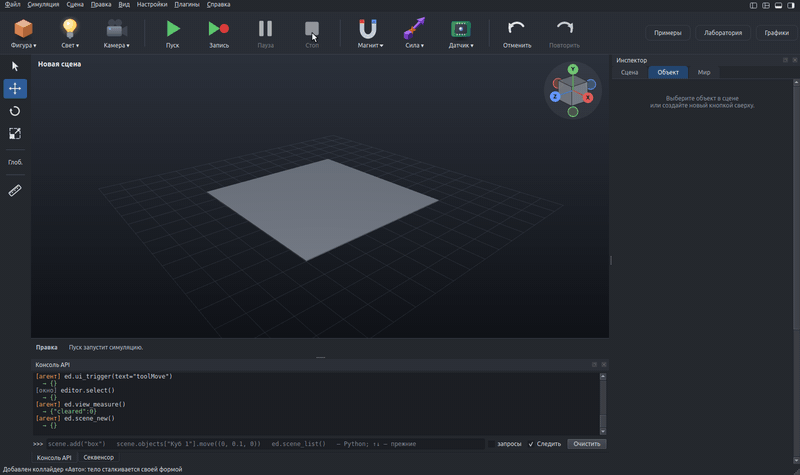<br><b>9 · Примеры.</b> «Примеры» справа вверху → галерея сцен → щелчок по картинке: сцена открыта. Рядом «Лаборатория» и «Графики».</td>
</tr>
</table>

## Готовая программа

Скачайте архив своей системы со страницы последнего выпуска —
**[Releases](https://github.com/Kinetica-Labs/kinetica-editor/releases/latest)**. Ставить Qt и собирать
ничего не нужно: в архиве программа со всеми библиотеками, примеры (UR5e с целью ИК, схватом и кубиками),
пакет Python для консоли и лицензии.

**Linux** (Ubuntu 22.04 и новее) — `kinetica-linux.tar.gz`:

```sh
tar -xzf kinetica-linux.tar.gz
./kinetica-linux/kinetica --scene kinetica-linux/usr/bin/examples/scenes/ur5e.kscene
```

**Windows** (10 и 11, 64 бита) — `kinetica-windows.zip`: распакуйте и запустите `kinetica.exe`; примеры
лежат рядом, в `examples` («Открыть…» начинает с этой папки).

Консоли Python внизу окна нужен Python 3: на Ubuntu он есть, на Windows поставьте с
[python.org](https://www.python.org/downloads/) и отметьте «Add python.exe to PATH». Без драйвера
OpenGL 3 окно предложит программный OpenGL. Скрипты и ИИ-агенты: клиент API — `tools/ke_editor.py`
рядом с программой (в Linux — `kinetica-linux/usr/bin/tools/`).

Сборки каждого изменения — в **Actions**: прогон **CI** → **Artifacts** (нужен вход в GitHub).

**Одной командой** — редактор из последнего выпуска в `~/Kinetica/editor`, проверка Python (поставить его скрипт
спросит) и плагин для Claude, если есть команда `claude`; запустите снова — обновит:

```sh
curl -fsSL https://raw.githubusercontent.com/Kinetica-Labs/kinetica-editor/main/install.sh | bash      # Linux, macOS
```

```powershell
irm https://raw.githubusercontent.com/Kinetica-Labs/kinetica-editor/main/install.ps1 | iex             # Windows
```

## Kinetica в Claude

Плагин `kinetica` даёт Claude операции редактора (MCP-сервер `ke-editor`) и навык строить, водить, измерять и
снимать роботов: модель собирает руку или машину в вашем окне, подписывает детали формулами, вы видите каждый вызов.
Нужны установленный редактор (выше) и Python 3.8+. В Claude Code:

```
/plugin install kinetica --marketplace Kinetica-Labs/kinetica-editor
```

или в два шага: `/plugin marketplace add Kinetica-Labs/kinetica-editor`, затем `/plugin install kinetica@kinetica`.
В приложении Claude: Настройки → Плагины → Добавить → маркетплейс `Kinetica-Labs/kinetica-editor`; работает во
вкладке Code (локальному MCP-серверу нужен ваш компьютер). На Windows в настройках плагина укажите Python: `python`
(скрипт `install.ps1` ставит это сам). Плагин ищет редактор в `~/Kinetica/editor` (Windows:
`%LOCALAPPDATA%\Kinetica\editor`) или в папке из настройки «Kinetica folder».

## Kinetica в Codex и ChatGPT

Тот же плагин читают Codex и приложение ChatGPT (`plugin.json` и `mcp.json` по схеме Agent Plugins):

```
codex plugin marketplace add Kinetica-Labs/kinetica-editor
codex plugin add kinetica@kinetica
```

В приложении ChatGPT: Плагины → Добавить → маркетплейс `Kinetica-Labs/kinetica-editor`, затем Kinetica → установить;
после — перезапустить приложение. Работает на этом компьютере (локальному MCP-серверу он нужен). Сервер запускается
как `python3`; редактор плагин ищет в `~/Kinetica/editor` (Windows: `%LOCALAPPDATA%\Kinetica\editor`), плагины
редактора — в `~/Kinetica/plugins`, если она есть.

## Сборка из исходников

Нужны компилятор C++17 (GCC 11+ или Visual Studio 2022), CMake 3.22+, Python 3 и Qt 6 — проверено с
Qt 6.7.3 (модули Core, Gui, Widgets, OpenGL, OpenGLWidgets, Network). Без Qt собираются только ядро и
его тесты. Qt проще всего поставить через [aqtinstall](https://github.com/miurahr/aqtinstall):

```sh
pip install aqtinstall
aqt install-qt linux desktop 6.7.3 linux_gcc_64 -O ~/Qt               # Linux
aqt install-qt windows desktop 6.7.3 win64_msvc2019_64 -O C:\Qt       # Windows
```

**Linux (Ubuntu):**

```sh
sudo apt install build-essential cmake ninja-build git python3 libgl1-mesa-dev libxkbcommon-x11-0 \
  libxcb-cursor0 libxcb-icccm4 libxcb-image0 libxcb-keysyms1 libxcb-randr0 libxcb-render-util0 libxcb-shape0
git clone --recurse-submodules https://github.com/Kinetica-Labs/kinetica-editor.git
cd kinetica-editor
cmake -S . -B build -G Ninja -DCMAKE_BUILD_TYPE=Release -DCMAKE_PREFIX_PATH=$HOME/Qt/6.7.3/gcc_64
cmake --build build -j4
```

**Windows (Visual Studio 2022, «Developer PowerShell»):**

```powershell
git clone --recurse-submodules https://github.com/Kinetica-Labs/kinetica-editor.git
cd kinetica-editor
cmake -S . -B build -DCMAKE_PREFIX_PATH=C:\Qt\6.7.3\msvc2019_64
cmake --build build --config Release --parallel 4
C:\Qt\6.7.3\msvc2019_64\bin\windeployqt build\Release\kinetica.exe   # библиотеки Qt рядом с программой
```

## Запуск и проверка

Язык окна выбирается в **Настройки → Язык** (**Settings → Language**). Редактор сохраняет выбор, сам перезапускается
и открывает текущую сцену вместе с несохранёнными правками. Для разового запуска на английском используйте `build/kinetica --language en`.
Каталог английских подписей лежит в `translations/kinetica_en.ts`. После изменения исходных строк
обновите его командой `cmake --build build --target update_translations`.

```sh
build/kinetica --scene examples/scenes/ur5e.kscene   # окно со сценой UR5e (Windows: build\Release\kinetica.exe)
build/ke_tests                                # тесты ядра
build/kinetica --self-test                    # самотест окна: жмёт кнопки, тащит гизмо; код выхода = ошибки
build/kinetica-core --version                 # программа без окна; python3 examples/python/01_hello.py
```

Скрипты и ИИ-агенты: `build/kinetica --api 47801` слушает API на 127.0.0.1 (JSON по строке на вызов).
Клиент на Python — `tools/ke_editor.py`, сервер MCP для агентов — `tools/ke_editor_mcp.py` (имя сервера `ke-editor`, порт — `KE_EDITOR_PORT`, иначе 47801).

Лицензия — MIT ([LICENSE](LICENSE)); чужой код и его лицензии — [THIRD_PARTY_NOTICES.md](THIRD_PARTY_NOTICES.md).

<p align="center">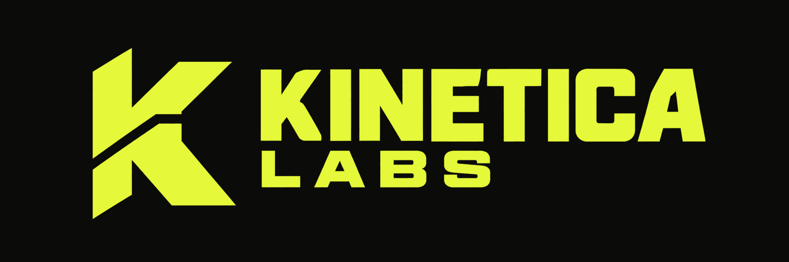</p>
