# Kinetica: a guide to the window

[Русский](interface.md) · **English**

<video src="images/showcase.mp4" autoplay muted loop playsinline controls width="100%">
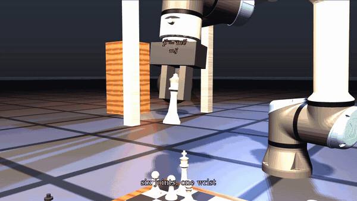
</video>

An editor of robots: you assemble a mechanism from bodies, joints, motors and sensors, press  Play - and physics shows how it behaves.


> **In five minutes** you will have a wall that a ball knocks down. **In half an hour** - a mechanism with a motor and a sensor.

| For whom | What you need | Checked on |
|---|---|---|
| for those who open the editor for the first time; no 3D experience needed | a running Kinetica editor | Kinetica 0.2.0, November 2026 |

## How to read this guide

1. **Do [the first five minutes](#first) with your own hands first.** Six steps, a picture for each.
2. **After that, open only the chapter you need.** Each one starts with a picture and fits on one screen.
3. **You cannot break anything.** `Ctrl+Z` undoes any edit, and  Stop brings the scene back as it was before  Play.

## What is inside

<table>
<tr>
<td width="33%" valign="top"><a href="#first"><br><b>1. The first five minutes</b></a><br>a wall and a ball, step by step</td>
<td width="33%" valign="top"><a href="#map"><br><b>2. The window: what is where</b></a><br>panels, tabs, the mouse</td>
<td width="33%" valign="top"><a href="#build"><br><b>3. Building a scene</b></a><br>shapes, the gizmo, roles, lights</td>
</tr>
<tr>
<td width="33%" valign="top"><a href="#robot"><br><b>4. Assembling a robot</b></a><br>the magnet, joints, sensors</td>
<td width="33%" valign="top"><a href="#run"><br><b>5. Running and watching</b></a><br>Play, plots, the Laboratory</td>
<td width="33%" valign="top"><a href="#anim"><br><b>6. Animation</b></a><br>the Sequencer and its keys</td>
</tr>
<tr>
<td width="33%" valign="top"><a href="#world"><br><b>7. The world</b></a><br>gravity and physics</td>
<td width="33%" valign="top"><a href="#more"><br><b>8. Faster and deeper</b></a><br>AI assistants, command search, scripts, plugins</td>
<td width="33%" valign="top"><a href="#keys"><br><b>Cheat sheet and help</b></a><br>keys; when something goes wrong</td>
</tr>
</table>
<a id="first"></a>

## 1. The first five minutes

**This is what you will get:**


Six steps, five minutes. Do them in order: at the end you will know the main loop of the work -
**add → set up → play → bring back**. Type the numbers without fear: whatever you do, `Ctrl+Z` undoes it.

### Step 1. An empty scene

Scene → New Empty Scene (`Ctrl+N`). Only the floor is left.


### Step 2. A brick

Press  Shape **(1)**, choose Cube **(2)** and click the floor: a
ready 0.2 m cube stands there. A drag instead of the click draws its base, the next click its height. One shape made,
the tool ends by itself; with Shift it makes the next one.


The cube appears selected, and its card opens on the right. In it, in order:

| # | Field | Value |
|---|---|---|
| 1 | Size, m | `0.24` · `0.15` · `0.2` |
| 2 | Position, m | `-0.5` · `0.075` · `0` |
| 3 | The  Rigid Body button | pressed - now it is a body, not just a picture |


> **Did it not work?** No card - click the cube: the card shows the selected object.

### Step 3. A wall of twenty bricks

With the brick selected: Edit → Create Array…. In the array's card:

| # | Field | Value |
|---|---|---|
| 1 | Kind | Grid |
| 2 | Count | `5` · `4` · `1` |
| 3 | Distance, m | `0.25` · `0.155` · `0.3` |


> **Did it not work?** The bricks stand in one line or inside each other - check Distance: the second number is the step up.

### Step 4. A ball

 Shape → Sphere, then the  Rigid Body button. In the card:

| # | Field | Value |
|---|---|---|
| 1 | The  Rigid Body button | pressed |
| 2 | Position, m | `0` · `0.4` · `1.7` |
| | Size, m | `0.3` · `0.3` · `0.3` |
| 3 | Density, kg/m3 | `4000` - heavy |
| | Speed, m/s - lower in the same card | `0` · `1.5` · `-7` - it flies at the wall |

You can also move the ball by hand: the arrows on it are the move gizmo.


> **Did it not work?** The ball is not in view - press `F`: the view frames the selection.

### Step 5. Play

Press  Play (`Space`).


| The hit | A second later |
|---|---|
|  |  |

> **Did it not work?** The ball fell short - the third number of Speed must be `-7`: the minus points at the wall.
> Nothing moves -  Rigid Body is not pressed on the ball or on the brick.

### Step 6. Stop

Press  Stop (`Shift+Space`). The wall is whole again:  Play spoiled nothing.


> **You can already:** add a shape, set its numbers in the card, make it a body, multiply it with an array, start and
> stop physics. Everything else in the editor is a variation of this loop.

### Try it yourself

Change one number and press  Play again.

**1. Make the ball light:** density `500` instead of `4000`. Will it break the wall?

<details><summary>Answer</summary>

No: a light ball bounces off and stays in front of the wall. The speed is the same, and the mass is eight times less.

</details>

**2. Switch on the Moon:** the World tab → the Moon button. What changes?

<details><summary>Answer</summary>

The ball and the bricks fly farther and fall slower: gravity on the Moon is six times weaker. The Earth button brings
the usual one back.

</details>

<a id="map"></a>

## 2. The window: what is where

> The lesson is over. What follows is a reference by task: no need to read it in order, open what you need.

The toolbar is everything that creates and runs:


| Buttons | What for |
|---|---|
|  Shape,  Light,  Camera,  Sensor,  Force | add to the scene |
|  Magnet | assemble a mechanism face to face |
| Joint | join two standing parts: an edge - a hinge along it, a face's centre - a shaft, a corner - a ball |
|  Play,  Record,  Pause,  Stop | the scene's time |
|  Undo,  Redo | a step back and forward |
| Examples, Laboratory, Plots | ready scenes and instruments |

On the right is the inspector with three tabs:

| Scene: the tree of objects | Object: the card of the selection | World: gravity and physics |
|---|---|---|
|  |  |  |

On the left are the tools, at the bottom the Sequencer and the console:

| Tools | The bottom panel |
|---|---|
|  |  |

Under the 3D view stands the mode - Edit, Play or Pause. The lowest line of the window says what the mouse does right
now. Four buttons in the top right corner hide and show the panels; `F11` leaves the 3D view alone.


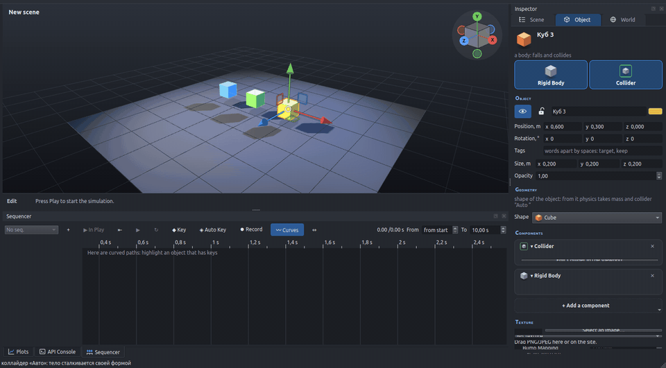

*The inspector at work: Scene - a row clicked selects the object; Object - roles, place, size, components; the collider Sphere; World - the world's settings.*

### The mouse in the 3D view

| Action | What it does |
|---|---|
| Left button | select an object; drag from empty space - a box |
| Right button | orbit; a click - the menu; with the button held `W` `A` `S` `D` - fly |
| Middle button | pan |
| Wheel | zoom |
| `F` | frame the selection; `Home` - the whole scene |
| `Shift+F` | follow the selected body: the camera keeps it in the middle while the world plays (turned on in edit - from ▶) |

The mouse layout is chosen in Settings → Controls.

<a id="build"></a>


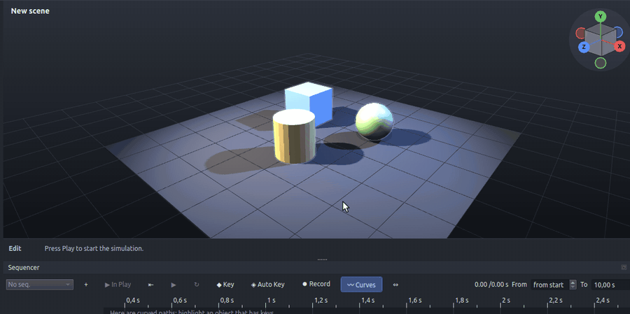

*The right button turns the view, the middle one moves it, the wheel zooms; a click on the cylinder and `F` - the view on it.*

## 3. Building a scene

### Shapes

 Shape adds a cube, a sphere, a cylinder, a cone or a plane - in the air over a free spot. Model takes the shape from
a file. An OBJ or STL model comes through File → Import… (Ctrl+I) as a shape of its own - named after the file, 1 m at its
largest side, standing on the floor (an agent or a script: `scene_import {file}`). A whole scene or a robot Import… brings
from glTF (`.gltf`, `.glb`) - nodes, meshes, colours and
animations, URDF - a robot with its joints. Back out - File → Export…: the scene's robot as URDF for ROS and Gazebo
(links, joints with their limits, masses; meshes beside it in a `<name>-meshes` folder), or the whole scene in one file -
«Kinetica Package» (`.kpkg`: the scene, its models, its textures) that Import… opens on any machine.


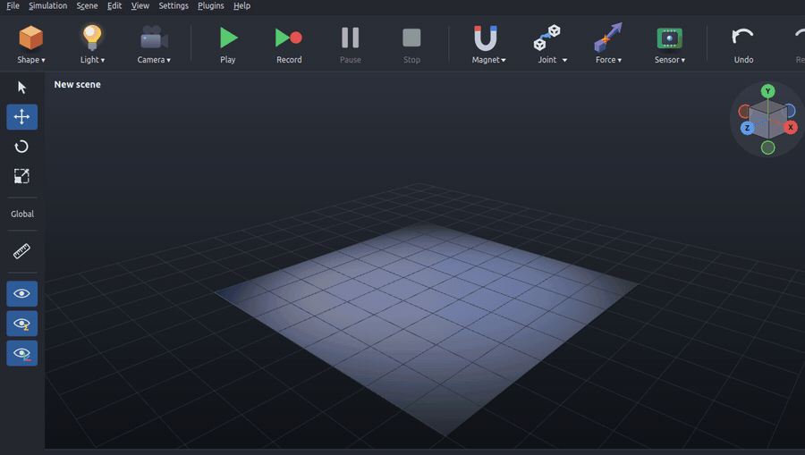

*A shape by mouse: Shape ▾ → Cube → drag the footprint on the floor → lift the height, click → Move → drag the X arrow: the label says how far.*

### Move, rotate, scale

Select an object and a tool on the left. An arrow, an arc or a cube leads along one axis; the small square between the
arrows - across a plane.

|  Move |  Rotate |  Scale |
|---|---|---|
|  |  |  |

- Ruler (`M`), a group of its own under a line, measures and moves nothing: press on a point of an object or the floor, drag to another, let go - the view
  shows the line and its length in metres. The line stays until the next one; Esc or another tool takes it off. As
  code - `view_measure {point, to}`.
- A turn released near a quarter of a revolution completes itself to it.
- The three eyes at the foot of the tools show and hide what stands over the scene: <b>Cards</b> plugins and agents put in
  the frame (a building step, a title, a part's glow), <b>Formulas and labels</b> in the scene itself (formulas, leaders,
  words over the parts) and <b>Editor marks</b> (joints, sensors, lights, cameras, the gizmo, colliders' frames). All three off - a
  clean frame, as a viewer sees it; an agent: `view_show {cards, labels, marks}`.


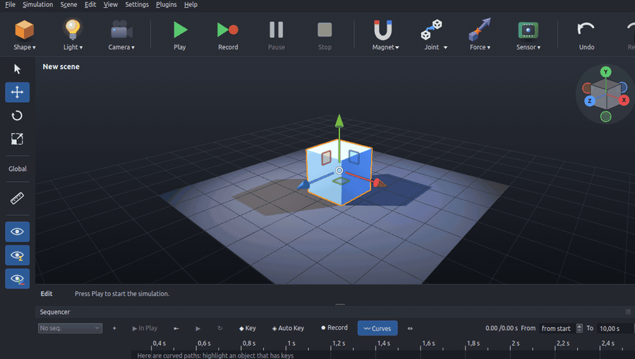

*Rotate - drag the ring; Scale - drag an axis's handle; Ruler - drag along the floor: the length over the line.*


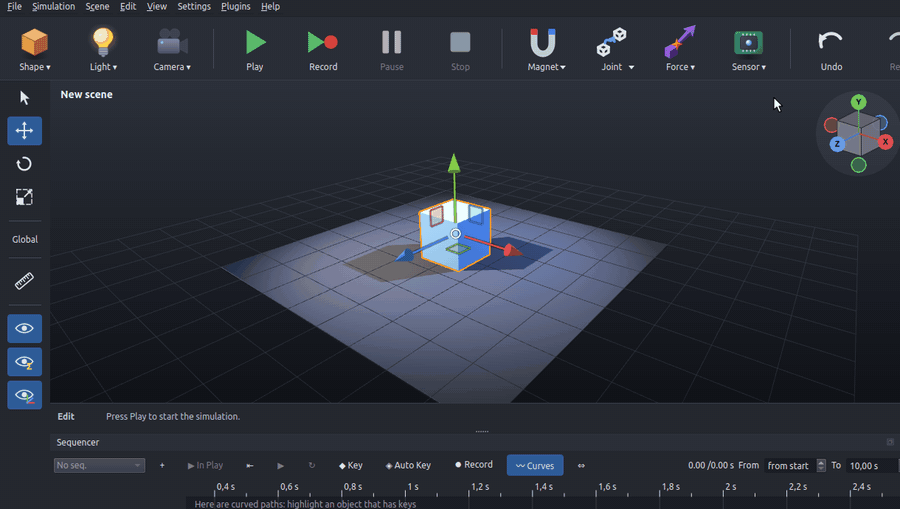

*Undo and Redo: the arrow carries the cube → Undo - the cube where it was → Redo - there again. Any edit is one undo: from the window, the console, a script or an AI agent.*


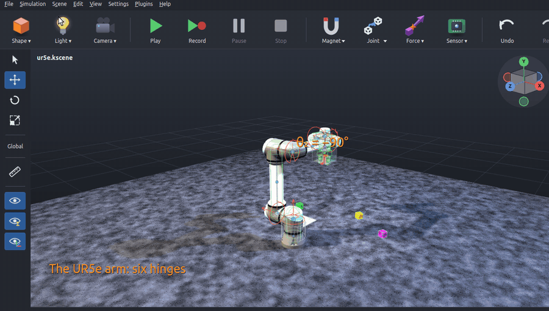

*The three eyes: Cards - the card in the frame goes; Formulas and labels - the label at the joint; Editor marks - the joints and the gizmo; a clean frame - and all back.*

### Roles: what physics knows

The two large buttons of the card are the shape's roles.

| Role | What it means |
|---|---|
| ** Rigid Body** | a body: density or a mass of its own, friction, restitution. The Body field chooses how it moves - see below |
| ** Collider** | what the body collides with; drawn as a green frame. Auto takes the shape's own form; Convex parts - a model of any shape cut into convex pieces (below); Mesh - the model's own triangles with all their hollows (a track, a terrain, a room) |
| neither | geometry only: it is seen, but physics does not know it |

### Convex parts: a body of any shape

Physics collides fast only what is convex - what a film could be stretched over with no dents. A mug, a ring, a steering
wheel, a bucket are not: Convex Hull would close the mug with a lid, and a ball would lie on top. The tile <b>Convex
parts</b> of the Collider card cuts the model into convex pieces that together keep its form: the mug's hollow stays a
hollow, the ring's hole a hole. Under the tile, two fields: <b>Parts at most</b> (1-64; 32 by default) and
<b>Concavity</b> - how far a piece may stand off the model, in per cent of its size (5 % by default); the card says how
many parts came out. The body may move or stand. An agent: `scene_collider {id, kind: "convex_parts", hulls, concavity}`.


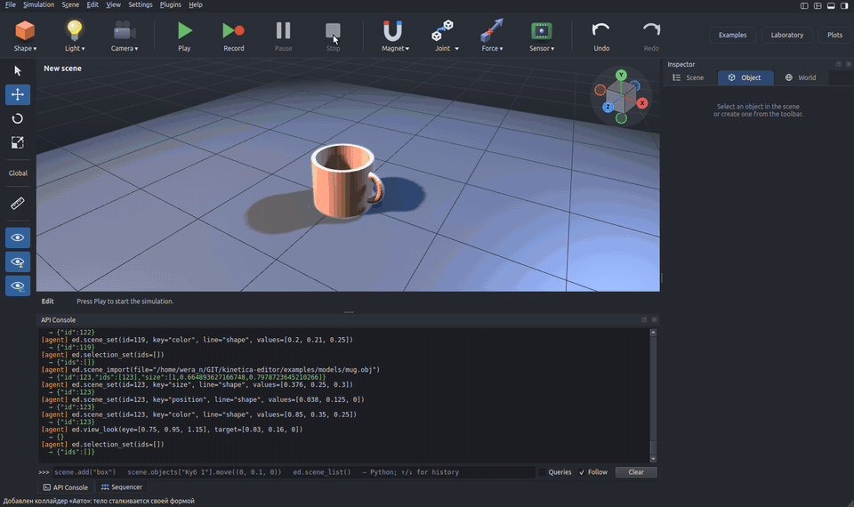

*The mug → Solid → the tile Convex parts: the green frame of sixteen pieces in the view → a ball over the mug → Play: it falls in and lies on the bottom, not on a lid.*

### Three kinds of body

The Body field of the  Rigid Body card:

| Kind | How it behaves | Example |
|---|---|---|
| **Dynamic** | physics moves it: it falls, collides, bounces | a crate, a ball, a robot's link |
| **Kinematic** | it moves as it is set - by its velocity or by a sequence; it pushes others, and nothing pushes it | a conveyor, a door, a lift |
| **Static** | it stands still | a wall, a table |

### Glass and whatever is seen through

The Opacity field of a shape's card: `1` is solid, less is see-through. That is how glass, a screen or a safety guard
is made. It is the look only: physics takes such a shape as any other.

### A zone: it notices and does not push

The Zone tick of the  Collider card makes an area of a shape: bodies pass through it, and it tells who stands inside.
That is how a bin a part is to reach is made, or an area around a robot that nothing may enter.


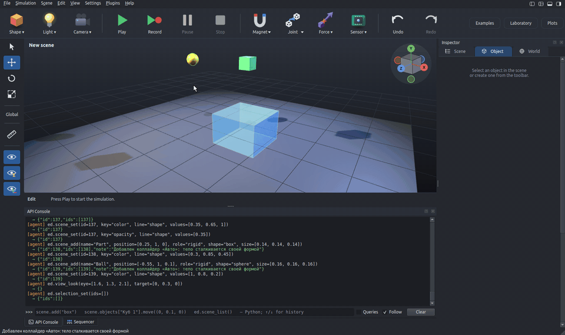

*A click on the basket → the tick zone in the Collider card → Play: the part goes into the basket, the ball falls beside it.*

```python
bin = scene.objects["Bin"]
scene.play()
scene.step(120)
print(bin.inside)        # what stands in the zone now
```

### Who does not collide with whom

A body can be taught not to notice others - by their tags:

```python
cover.tag("cover")
part.ignores = ["cover"]   # the part passes through whatever is tagged "cover"
```

The rule works both ways. The links of one robot do not collide with each other without it.

### Tags

The card of any object has a Tags field - words apart by spaces: `target`, `keep`, `robot-1`. By themselves they do
nothing: scripts and plugins find the object by them.

```python
for target in scene.objects.tagged("target"):
    print(target.name)
```

A tag goes on anything - a shape, a joint, a sensor, a light, a force.

### Lights and cameras

 Light puts a sun, a point light or a spotlight.  Camera - a free camera or a target camera, which always looks at its
object.


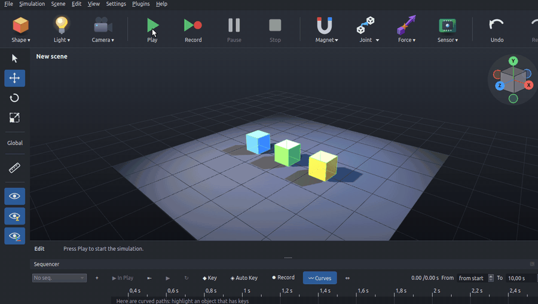

*Light ▾ → Spot: a click - where it stands, a second - its height, a third - where it shines → select the cube → Force ▾ → Push → Play: the cube is thrown up.*

### Forces

 Force ▾ puts what pushes bodies, once or all the time, and a torque that turns a body. There are five kinds.


| | Once - an impulse | All the time - a force |
|---|---|---|
| **On one body** - an arrow | Push | Thrust |
| **A field around a point** - a sphere | Blast | Pull |

**A torque on a body.** Select a body and press Torque: it turns the body about its own +Y axis wherever on the body
it stands - a ring with an arrow shows which way; the gizmo turns the axis. Its strength is Torque, N·m; the Impulse
mode in the card makes it a single Angular impulse, N·m·s. With no body selected no torque is made: it has nothing to
turn.

**A force on a body.** Select a body with the  Rigid Body role and press Push or Thrust. The arrow stands at the body's
centre of mass; the force acts on that body alone and rides on it.


- **The orange point at the end of the arrow is the whole vector.** Drag it: where it points the force pushes, and the
  arrow's length is its strength. A metre of arrow is 3 m/s of the body's velocity for a push and 10 m/s² of
  acceleration for a thrust; a thrust up longer than a metre lifts the body.
- **The gizmo moves the start of the arrow.** Off the centre of mass the force turns the body.
- **A push fires once** - when the scene starts or at its own Time, s - and after that its arrow is gone in play until
  the scene is stopped. A thrust acts all the time, and its arrow stays.
- On a shape with no  Rigid Body role the arrow is pale and the card says "no physics": give the role and the force is
  live.

**A field.** A Blast and a Pull act on every body whose centre is inside the sphere - light or heavy alike: a blast
gives the bodies a velocity (6 m/s, weaker toward the sphere's edge), a pull an acceleration toward its point
(15 m/s²). The sphere shows on the selected field; the orange point on it is the radius.


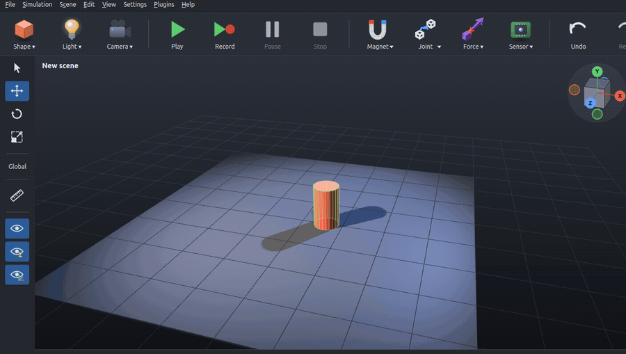

*A click on the barrel → Force ▾ → Blast: it stands at its side, the sphere showing whom it reaches → Play: the barrel is thrown.*

A Push and a Thrust made with no body selected are fields too: they push everything in their radius one way.

**The force's card** says whose it is: "Body: Cube" or "Field". A force on a body has its strength as Impulse, N s or
Strength, N; a field has Speed, m/s or Acceleration, m/s², and also Radius, Falloff (how the field weakens toward
its edge) and Acts on - only bodies with that tag. The Fire button gives the impulse now, in the running scene.


A robot does not look at a force: it learns of it only through its sensors - the IMU, the encoders, the effort.

```python
push = scene.add_force("directional", "impulse", body=cube)   # a push on a body: an arrow from its centre of mass
boom = scene.add_force("radial", "impulse", at=(0, 0.5, 0), strength=6, radius=3)   # a blast: 6 m/s to all in the radius
boom.fire()                                                    # in the running world, at once
```

### Copies, groups, arrays

| Action | Key |
|---|---|
| Duplicate | `Ctrl+D` |
| Group / Ungroup | `Ctrl+G` / `Ctrl+Shift+G` |
| Hide Selection / Show Hidden Objects | `H` / `Alt+H` |
| Delete | `Delete` |

Create Array… turns a shape into the template of a row, a grid or a circle of copies - that is how the wall of the
first lesson was made. Convert to Separate Objects in the array's card makes the copies shapes of their own.

<a id="robot"></a>

## 4. Assembling a robot

### The magnet

 Magnet assembles a mechanism face to face - three moves:

| 1. Point at a face | 2. Hold and drag - the menu | 3. A click or a choice - the link stands |
|---|---|---|
|  |  |  |

A plain click puts the ready link with the star - the one the editor finds fitting for this place.

| Key | What it does |
|---|---|
| `1`–`5` | choose a ready link: Rotation, Travel, Wheel, Fixed Joint, Ball Joint |
| `0` | the hint for the place |
| `A` / `Tab` | rotate the axis / flip it |
| `M` | mirror |
| `Esc` | leave the magnet |


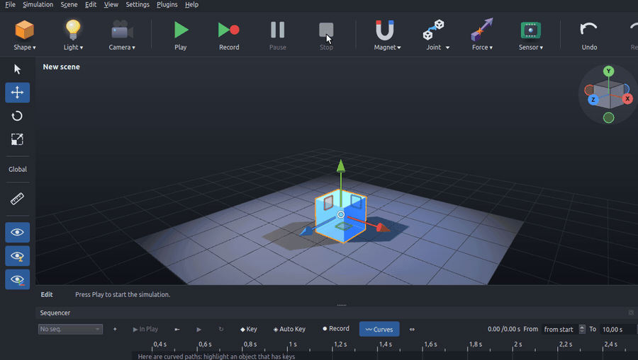

*Magnet → over a face: the link's ghost → a click: a link on a hinge → a click on the new link → Esc → Sensor ▾ → IMU on the selected link.*


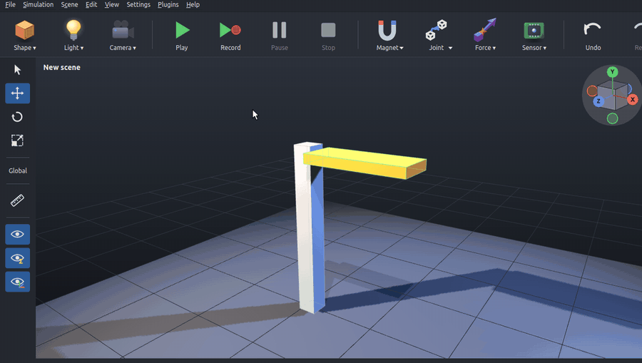

*Joint → over the plank's top edge at the post: the hinge's axis and the swinging ghost → a click → a click on the post → Play: the plank falls and swings like a lid.*

### Joints and actuators

A joint is an object of the scene with a card of its own: the axis and the anchor, the limit, the actuator. A position
servo holds an angle by a spring with stiffness and damping.


The card shows the angle, the target and the torque after  Play: in Edit there are no motors.

### Sensors

Select a body or a joint and press  Sensor. On a body go an IMU, a sonar, a lidar and a contact sensor; on a joint - an encoder,
a force/torque sensor and an actuator effort sensor.


A sensor has a datasheet: a model from the table and its numbers - range, beam angle, accuracy, noise.


**Lidar** - one sensor whose rays are set by its numbers: Horizontal rays and Horizontal field, the same vertically.
One ray is a range finder; 360 rays over 360° - a ring around the robot; layers over 180° - a sphere; an 8 x 8 grid
in a narrow field - a flashlight. Each ray sees a surface at any angle, unlike a sonar, which a slanted wall does not
answer. On a side face its ring lies level; in play the rays reach what they hit.

> A robot's control reads only such sensors - with noise, quantisation and delay, as a real device has.

<a id="run"></a>

## 5. Running and watching

### Play, Pause, Stop

| Button | Key | What it does |
|---|---|---|
|  Play | `Space` | builds a live world from the scene and starts physics |
|  Pause | | stops time; Step in the Simulation menu moves the world one frame |
|  Stop | `Shift+Space` | brings the scene back as it was before  Play |

After  Play the view has a frame around it. Keep Simulated Poses (`K`) carries the bodies' poses from the simulation
into the scene.


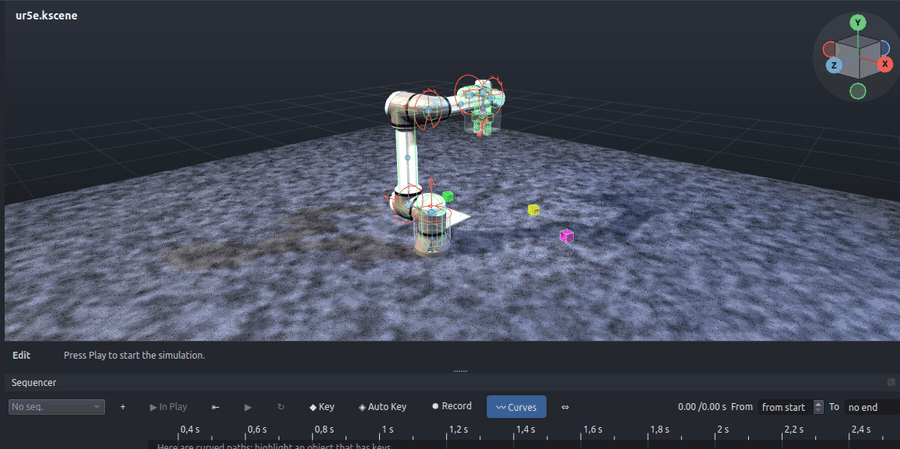

*A robot at play: the UR5e example → Play → D, W, F, A lead the gripper's target, the arm follows by inverse kinematics → space closes the gripper.*

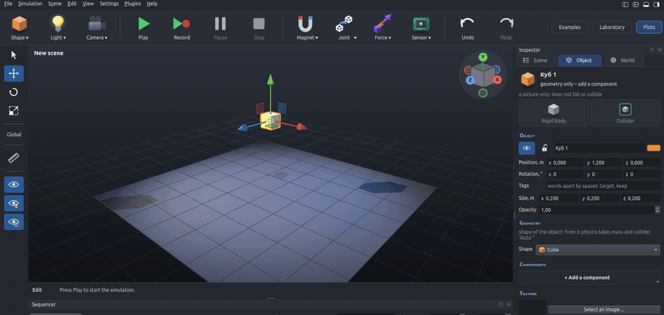

*A cube in the air → the tile Solid → Play: it falls, the view's frame and the toolbar green → Stop: the cube where it stood.*

### Plots

Plots (`F9`, the «Plots» button at the top right) - all that changes over time: the scene's energy, the selected
object's height and speed, the plugins' lines (the depz sensor, the Brain's training). On the left - «What to show»,
on the right - the plots, under them - the bar with the layouts and the buttons.

| I want to | How |
|---|---|
| keep only the plots I need | on the left, in «What to show», untick the others; a section's tick («Scene», a plugin) is all its plots |
| find a plot | the «Find a plot…» line over the list keeps the plots whose name has those letters |
| zoom the time | the mouse wheel over a plot, away - closer, towards you - farther; every plot of the same axis zooms with it, so one moment stands above another |
| zoom the values | Shift + the wheel over a plot - only this plot, in height |
| move a zoomed plot | hold the left button on the plot and drag |
| **get the whole plot back** | **↺** in the plot's top right corner (there while it is zoomed) or right click → «Whole plot (↺)»; the plot then follows live again |
| **get everything back as it was** | when the view is not the plain one, the bar under the plots says in yellow what is changed («zoomed · plots hidden: 2»), and beside it **«Reset view»**: all plots, not zoomed, live |
| save a view and come back to it | the ▤ button («Layout») left of the find line → «Save as…»; later the same menu - by its name; «Delete» - remove it |
| one plot large | a double click on the plot (not on its legend); all back - another double click or «◂ All plots» |
| hide one line | a click on its name in the legend; a double click - only it |
| the plots the window's whole width | ⇔ on the bar under the plots (or «View → Full-width bottom panel») |
| the plots taller | drag up the `……` strip between the 3D view and the plots |
| the plots in a window of their own, on a second screen | a double click on the «Plots» title; back - a double click on its window's title |
| one under another / every line 0 to 1 | «Stacked» / «Normalize» on the bar; «Overlay» - back |
| add a quantity | «More Channels…» or right click → «Add Channel…» |
| save the numbers | «Save the CSV» - the plots' lines to a file |

A plugin's plots are always here, not in its panel: the plugin's panel has a «Plots ▸» button that opens this tab.


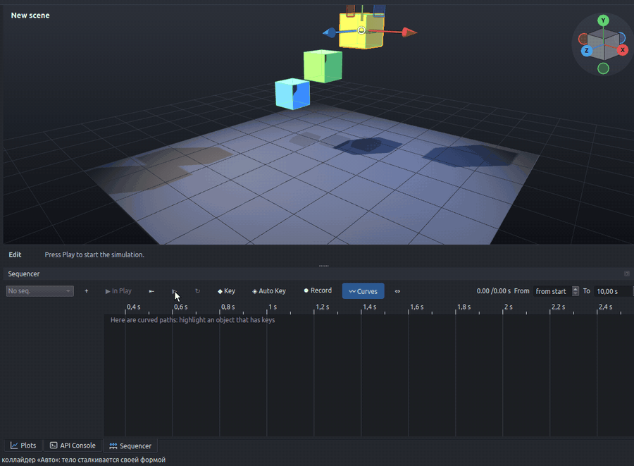

*Plots at work: pick the channels → Play - the curves grow with the scene.*

### The Laboratory

Laboratory (`F8`) shows what the engine computes right in the view: contact points, normals, forces, penetration, the
colliders of all bodies. A click on a contact point or a body opens a card with its numbers.


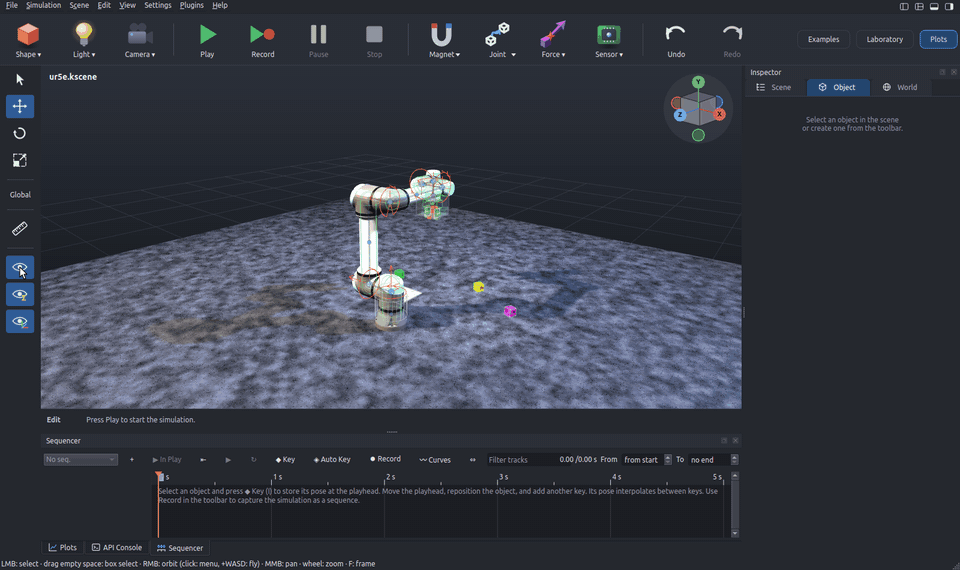

*Laboratory → Center of mass: a mark on each of the arm's links → the tick off.*

### Performance

The plate (`F3`) writes frames per second, the time of a frame and of a physics step, and the scene's speed against
real time.


<a id="anim"></a>

## 6. Animation: the Sequencer

Three actions:

1. Select an object and press Key (`I`) - the sequence remembers where it stands at the playhead's moment.
2. Move the playhead and put the object elsewhere.
3. Press Key again - between the keys the object travels by itself.

Without Auto Key the order is: the playhead first, then the move, then Key - a key holds the pose the object has when it is put, and a seek puts the object back on its track. With ◈ Auto Key the order is shorter: switch it on, set the playhead and just move or turn the object - its key is put by itself (a sequence is made when there is none), and the move and its key are one undo step. The button is off by default.


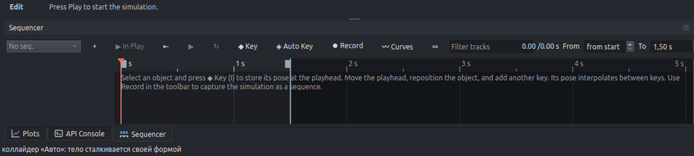

*The Sequencer: the objects' tracks, keys on the scale, curves between them.*

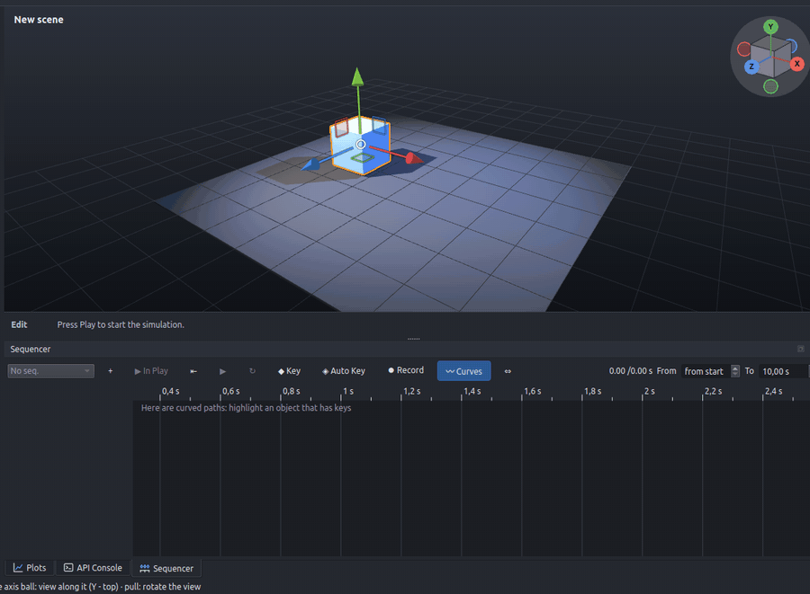

*◆ Key at 0 s → the playhead to 2 s → the arrow carries the cube → ◆ Key → drag the playhead back and forth: the cube follows its track → ▶ Preview.*

The object's track and its keys - the diamonds on the time scale:


 Record (`Ctrl+R`) plays the scene and records the bodies' motion as a new sequence. The tracks of the sequence that played during the recording - a camera's keys, a light's - come along into the take: whether the camera or the physics comes first does not matter. Loop repeats the sequence.

**Playback time and the take's window.** The To field at the right of the panel is where the animation and the take end. Play without a take does not stop there: physics is not the animation, the world goes on until it is stopped, and the keys past the last one hold their pose (with Loop - repeat from the start). The From field sets where a take starts: before it the world runs and nothing is recorded, so memory goes to the part you need only. At To the take closes, the scene pauses and ▶ watches the physics on without recording; the take comes into the Sequencer with ■ Stop - a new sequence, its keys at their seconds. Both ends are grey flags on the time scale: drag them with the mouse; they never pass each other. A new scene starts with the range 0-10 s. "No end" (0): a take with no To ends by itself after two minutes.

**Closer.** Curves show one track: its place or turn along x, y, z over time; a key's dot is dragged up and down (its value) or sideways (its time). A key clicked shows its Bezier handles - the curve's slope through the key: drag a handle up or down, the other turns with it, the curve stays smooth and the segments on both sides become smooth. The place has handles; the turn has none. The gestures are the 3D view's: the wheel zooms the time about the mouse, Shift+wheel the values, the middle button moves the view, F shows the whole. The time's zoom is one for the curves and the tracks; on the tracks the wheel over the ruler, or Ctrl+wheel, zooms the time, and the plain wheel scrolls the rows.

<a id="world"></a>

## 7. The world

The World tab holds the settings of the whole scene.

| Section | What is inside |
|---|---|
| Gravity | gravitational acceleration; the buttons Earth, Moon, Zero Gravity |
| Rigid Body Contacts | substeps per frame, contact stiffness and damping, continuous collision detection |
| Joints | stiffness and damping |
| Sleeping and Damping, World Size | folded, a click opens them |

Reset Physics brings the defaults back. The picture of the tab is [in the chapter about the window](#map).


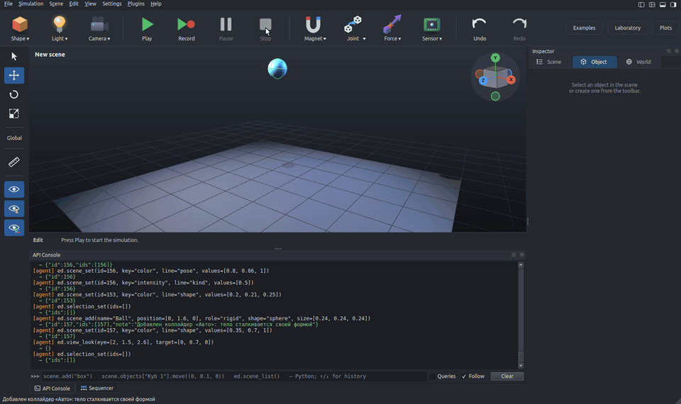

*The World tab → Moon: gravity six times weaker → Play: the ball falls slowly → Earth.*

<a id="more"></a>

## 8. Faster and deeper

### AI assistants: Claude, ChatGPT and Codex

Kinetica is a tool for AI. <b>File → Connect AI assistants…</b> finds the Claude app, Claude Code, ChatGPT and Codex on
this computer and connects Kinetica to each with one button. Restart the assistant and ask in its chat: "build a car with
a lidar and check that it drives around a wall", "explain this pendulum with formulas". The assistant builds, runs and
measures the robot in your window: you see each of its steps, and each step is one undo and a line of the journal, so
any of its edits can be taken back. Disconnect takes Kinetica out of the assistant; the rest of its settings stay.


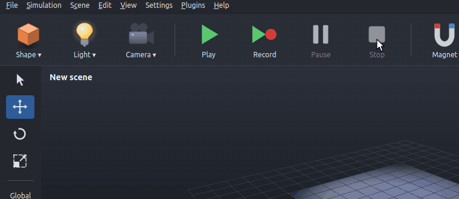

*File → Connect AI assistants… → Claude not connected → Connect → connected: the window asks to restart Claude.*

### Find Command

`Ctrl+K` searches all the commands of the window. Type a part of a name - "group", "collider", "save" - and press
`Enter`. When you do not remember where a button is, start here.


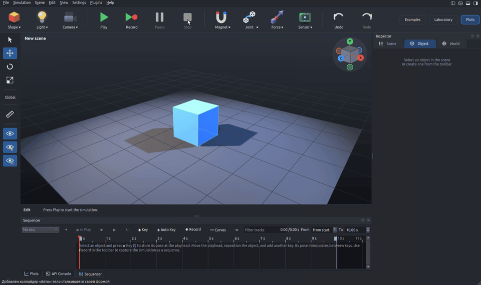

*`Ctrl+K` → «labora» → Laboratory on the first row → `Enter`: its panel open.*

### The API console

Every action of the window is an operation, and the console writes it as a line of Python. The line can be copied
into a script, and your own can be typed into the field below.


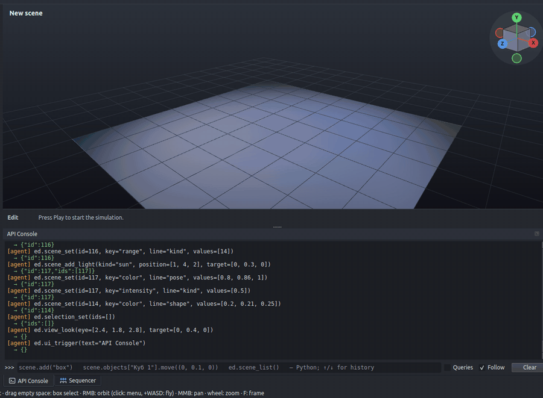

*The console: every action of the window stands as a line of Python; a line of your own below does the same.*

### Scripts

File → Run Script… runs a Python file that builds or changes the scene; everything it did is one undo step. Here
`examples/scripts/ur5e_cubes.py` stacked a pyramid of cubes beside the arm. In detail - [scripts.md](scripts.md) (in
Russian).


### Plugins

A plugin gives the editor a new skill. The Plugins menu makes a plugin from a template, adds a folder of plugins and
restarts them; the plugins' commands stand here too. In detail - [plugins.md](plugins.md) (in Russian).

<b>Kinetica Replay</b> (the plugin `replay`) plays a session of work back - yours, a script's or an AI agent's - as a film
of its building: the first scene, then every step in turn with a card, the part lit and the camera flying to it, and
where the session pressed Play the scene plays. The sessions come from the window's journal, the example films from
`examples/films`.


### Examples

Examples opens the gallery of scenes: a click on a picture opens the scene, and it can be changed and saved.


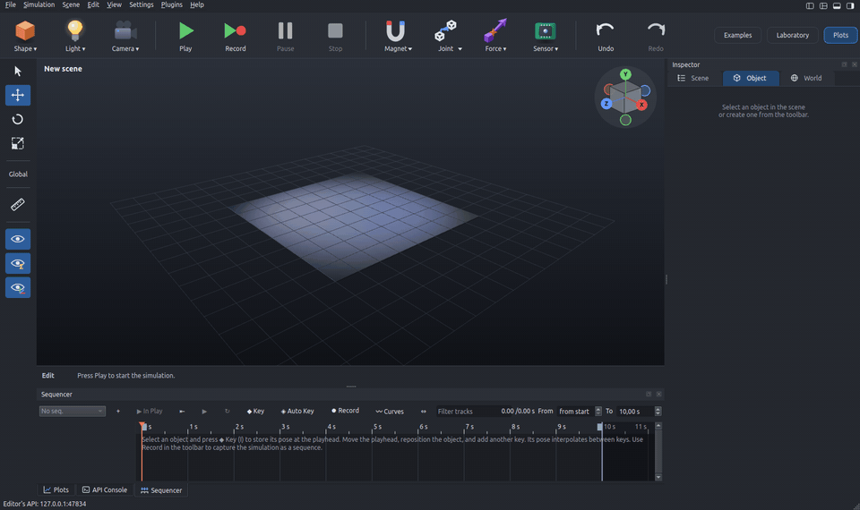

*Examples → a click on a picture - the scene open, to change and to save.*

### Language and settings

Settings → Language switches the window between Russian and English. The mouse scheme and Software Rendering
(requires a restart) are there too.


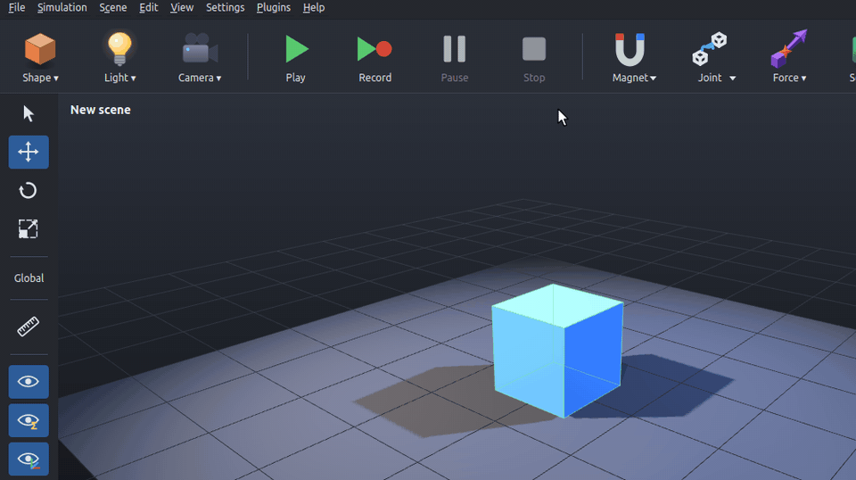

*Settings → Language → Русский or English: the window is translated at once, no restart.*

<a id="keys"></a>

## Cheat sheet of keys

| What | Key | | What | Key |
|---|---|---|---|---|
|  Play | `Space` | |  Undo | `Ctrl+Z` |
|  Stop | `Shift+Space` | |  Redo | `Ctrl+Shift+Z` |
|  Record | `Ctrl+R` | | Duplicate | `Ctrl+D` |
| Keep Simulated Poses | `K` | | Group | `Ctrl+G` |
| Find Command | `Ctrl+K` | | Delete | `Delete` |
| Frame Selection | `F` | | Hide / Show Hidden | `H` / `Alt+H` |
| Entire Scene | `Home` | | Select All | `Ctrl+A` |
| Follow Selected | `Shift+F` | | | |
| A Sequencer key | `I` | | New scene | `Ctrl+N` |
| Plots | `F9` | | Open / Save | `Ctrl+O` / `Ctrl+S` |
| Laboratory | `F8` | | 3D View Only | `F11` |
| Performance | `F3` | |  Stop / Deselect | `Esc` |

## When something goes wrong

| What you see | Why, and what to do |
|---|---|
| An object does not fall | it has no  Rigid Body role - or its Body field is not Dynamic |
| A body falls through another | one of them has no  Collider role |
| After  Stop everything came back | it is meant to. To keep it, press Keep Simulated Poses (`K`) on pause |
| You lost an object from view | `F` - to the selection, `Home` - the whole scene |
| You did the wrong thing | `Ctrl+Z`. Any edit is undone |
| You do not remember where a button is | `Ctrl+K` and the first letters of its name |

## Retaking the pictures

```sh
python3 tools/ui_guide_shots.py              # every picture, both languages, into docs/images/ui/<ru|en>/
python3 tools/ui_guide_shots.py en magnet    # one language, only the named groups
python3 tools/ui_guide_icons.py --write     # the window's icons beside the buttons' names in the guide's text
```

The script starts the editor without showing a window, does every function by its operation and photographs the
window with the `view_screenshot` operation. When the window changes, the pictures are retaken by one command.

The film at the head of the guide is the scene of the plugin `showcase` from the kinetica-plugins repository: its
panel «Витрина» has «Собрать сцену» (the arm, the chessboard, the pendulum, the tower, formulas, textures, lights, a
keyed camera), then ▶. It is shot the same way, a frame at a time: `python3 tools/showcase_film.py --plugins ../kinetica-plugins`
presses those two buttons, steps the simulation a frame and saves each - through the scene's camera (`view_through`,
`view_screenshot {clean, marks: false}`) and as the editor's window -, then cuts the video and the GIF with ffmpeg into
`build/showcase/`. Nothing is done to the picture; at the end the camera draws back out of the view to the whole window.