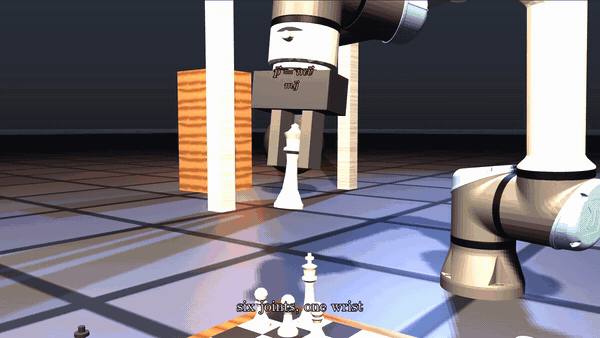

# Kinetica: руководство по окну

**Русский** · [English](interface.en.md)

<video src="images/showcase.mp4" autoplay muted loop playsinline controls width="100%">

</video>

Редактор роботов: вы собираете механизм из тел, суставов, моторов и датчиков, нажимаете  «Пуск» — и физика показывает, как он себя поведёт.


> **Через пять минут** у вас будет стена, которую разбивает шар. **Через полчаса** — механизм с мотором и датчиком.

| Для кого | Что нужно | Проверено |
|---|---|---|
| для тех, кто открыл редактор впервые; опыт в 3D не нужен | запущенный редактор Kinetica | Kinetica 0.2.0, ноябрь 2026 |

## Как читать это руководство

1. **Сначала сделайте [первые пять минут](#first) своими руками.** Это шесть шагов, каждый с картинкой.
2. **Дальше открывайте только нужную главу.** Каждая начинается с картинки и умещается на одном экране.
3. **Сломать ничего нельзя.** `Ctrl+Z` отменяет любую правку, а  «Стоп» возвращает сцену такой, какой она была до пуска.

## Что внутри

<table>
<tr>
<td width="33%" valign="top"><a href="#first"><br><b>1. Первые пять минут</b></a><br>стена и шар — по шагам</td>
<td width="33%" valign="top"><a href="#map"><br><b>2. Окно: где что</b></a><br>панели, вкладки, мышь</td>
<td width="33%" valign="top"><a href="#build"><br><b>3. Строим сцену</b></a><br>фигуры, гизмо, роли, свет</td>
</tr>
<tr>
<td width="33%" valign="top"><a href="#robot"><br><b>4. Собираем робота</b></a><br>магнит, суставы, датчики</td>
<td width="33%" valign="top"><a href="#run"><br><b>5. Запускаем и смотрим</b></a><br>пуск, графики, Лаборатория</td>
<td width="33%" valign="top"><a href="#anim"><br><b>6. Анимация</b></a><br>секвенсор и ключи</td>
</tr>
<tr>
<td width="33%" valign="top"><a href="#world"><br><b>7. Мир</b></a><br>гравитация и физика</td>
<td width="33%" valign="top"><a href="#more"><br><b>8. Быстрее и глубже</b></a><br>поиск команд, скрипты, плагины</td>
<td width="33%" valign="top"><a href="#keys"><br><b>Шпаргалка и помощь</b></a><br>клавиши; если что-то не так</td>
</tr>
</table>
<a id="first"></a>

## 1. Первые пять минут

**Вот что получится:**


Шесть шагов, пять минут. Делайте их по порядку: в конце вы будете знать главный круг работы —
**добавить → настроить → пустить → вернуть**. Числа можно вводить не глядя: что бы вы ни сделали, `Ctrl+Z` отменит.

### Шаг 1. Пустая сцена

«Сцена → Новая пустая сцена» (`Ctrl+N`). Останется один пол.


### Шаг 2. Кирпич

Нажмите  «Фигура» **(1)**, выберите «Куб» **(2)** и щёлкните по полу:
там встанет готовый куб 0,2 м. Протяжка вместо щелчка рисует основание, следующий щелчок — высоту. После одной
фигуры инструмент выключается сам; с Shift — ставит следующую.


Куб появился и выбран — справа открылась его карточка. В ней по порядку:

| № | Поле | Значение |
|---|---|---|
| 1 | Размер, м | `0,24` · `0,15` · `0,2` |
| 2 | Где, м | `-0,5` · `0,075` · `0` |
| 3 | Кнопка  «Твёрдое» | нажата — теперь это тело, а не просто картинка |


> **Не получилось?** Карточки нет — щёлкните по кубу: она показывает выбранный объект.

### Шаг 3. Стена из двадцати кирпичей

Кирпич выбран → «Правка → Сделать массивом…». В карточке массива:

| № | Поле | Значение |
|---|---|---|
| 1 | Вид | «Сетка» |
| 2 | Сколько | `5` · `4` · `1` |
| 3 | Расстояние, м | `0,25` · `0,155` · `0,3` |


> **Не получилось?** Кирпичи стоят в одну линию или друг в друге — проверьте «Расстояние»: вторая цифра — шаг вверх.

### Шаг 4. Шар

 «Фигура → Сфера», кнопка  «Твёрдое». Дальше в карточке:

| № | Поле | Значение |
|---|---|---|
| 1 | Кнопка  «Твёрдое» | нажата |
| 2 | Где, м | `0` · `0,4` · `1,7` |
| | Размер, м | `0,3` · `0,3` · `0,3` |
| 3 | Плотность, кг/м³ | `4000` — тяжёлый |
| | Скорость, м/с — ниже в той же карточке | `0` · `1,5` · `-7` — летит в стену |

Двигать шар можно и рукой: стрелки на нём — это гизмо перемещения.


> **Не получилось?** Шара не видно — нажмите `F`: вид покажет выбранное.

### Шаг 5. Пуск

Нажмите  «Пуск» (`Пробел`).


| Удар | Через секунду |
|---|---|
|  |  |

> **Не получилось?** Шар упал, не долетев, — в «Скорость» третья цифра должна быть `-7`: минус — в сторону стены.
> Ничего не движется — у шара или кирпича не нажато  «Твёрдое».

### Шаг 6. Стоп

Нажмите  «Стоп» (`Shift+Пробел`). Стена снова целая: пуск ничего не испортил.


> **Вы уже умеете:** добавить фигуру, задать её числа в карточке, сделать её телом, размножить массивом, пустить и
> остановить физику. Всё остальное в редакторе — вариации этого круга.

### Попробуйте сами

Измените одно число и снова нажмите  «Пуск».

**1. Сделайте шар лёгким:** плотность `500` вместо `4000`. Пробьёт ли он стену?

<details><summary>Ответ</summary>

Нет: лёгкий шар отскакивает и остаётся перед стеной. Скорость та же, а массы в восемь раз меньше.

</details>

**2. Включите Луну:** вкладка «Мир» → кнопка «Луна». Что изменится?

<details><summary>Ответ</summary>

Шар и кирпичи летят дальше и падают медленнее: притяжение на Луне в шесть раз слабее. Кнопка «Земля» возвращает
обычное.

</details>

<a id="map"></a>

## 2. Окно: где что

> Урок закончен. Дальше — справочник по задачам: читать подряд не нужно, открывайте то, что понадобилось.

Верхняя панель — всё, что создаёт и запускает:


| Кнопки | Зачем |
|---|---|
|  «Фигура»,  «Свет»,  «Камера»,  «Датчик»,  «Сила» | добавить в сцену |
|  «Магнит» | собрать механизм по граням |
| «Сустав» | соединить две стоящие детали: ребро — петля, центр — вал, угол — шар |
|  «Пуск»,  «Запись»,  «Пауза»,  «Стоп» | время сцены |
|  «Отменить»,  «Повторить» | шаг назад и вперёд |
| «Примеры», «Лаборатория», «Графики» | готовые сцены и приборы |

Справа — инспектор с тремя вкладками:

| «Сцена»: дерево объектов | «Объект»: карточка выбранного | «Мир»: гравитация и физика |
|---|---|---|
|  |  |  |

Слева — инструменты, снизу — секвенсор и консоль:

| Инструменты | Нижняя панель |
|---|---|
|  |  |

Под 3D-видом написан режим — «Правка», «Пуск» или «Пауза». Самая нижняя строка окна подсказывает, что сейчас делает
мышь. Четыре кнопки в правом верхнем углу прячут и показывают панели; `F11` оставляет один 3D-вид.

### Мышь в 3D-виде

| Действие | Что делает |
|---|---|
| Левая кнопка | выбрать объект; тянуть с пустого места — рамка |
| Правая кнопка | осмотр; щелчок — меню; с зажатой кнопкой `W` `A` `S` `D` — полёт |
| Средняя кнопка | панорама |
| Колесо | приблизить и отдалить |
| `F` | показать выбранное; `Home` — всю сцену |
| `Shift+F` | следить за выбранным телом: камера держит его в центре, пока мир играет (включите в правке — с ▶) |

Раскладка мыши выбирается в «Настройки → Управление».

<a id="build"></a>

## 3. Строим сцену

### Фигуры

 «Фигура» добавляет куб, сферу, цилиндр, конус или плоскость — в воздухе над свободным местом. «Модель» берёт форму из
файла. Целую сцену или робота приносит «Файл → Импорт…» (Ctrl+I): glTF (`.gltf`, `.glb`) — узлы, сетки, цвета и анимации,
URDF — робот с суставами. Обратно — «Файл → Экспорт…»: робот сцены в URDF для ROS и Gazebo (звенья, суставы с
пределами, массы; сетки — рядом в папку `<имя>-meshes`), или вся сцена одним файлом — «Пакет Kinetica» (`.kpkg`: сцена,
модели, текстуры), который «Импорт…» открывает на любой машине.


### Переместить, повернуть, растянуть

Выберите объект и инструмент слева. Стрелка, дуга или кубик ведут по одной оси; квадратик между стрелками — по
плоскости.

|  Перемещение |  Вращение |  Масштаб |
|---|---|---|
|  |  |  |

- «Глоб.» переключает оси гизмо между мировыми и собственными осями объекта.
- «Линейка» (`M`) — отдельно, под чертой: меряет, ничего не двигая: нажмите на точку объекта или пола, тяните к другой, отпустите — в виде линия и её
  длина в метрах. Линия стоит до следующей; Esc или другой инструмент её убирают. Кодом — `view_measure {point, to}`.
- Поворот, отпущенный рядом с четвертью оборота, доводится до неё сам.

### Роли: что знает физика

Две большие кнопки в карточке — роли фигуры.

| Роль | Что значит |
|---|---|
| ** Твёрдое** | тело: плотность или своя масса, трение, упругость удара. Поле «Тело» выбирает, как оно движется, — см. ниже |
| ** Коллайдер** | то, чем тело сталкивается; виден зелёным каркасом. «Авто» берёт форму самой фигуры; «Сетка» — сами треугольники модели со всеми впадинами (трасса, рельеф, комната), только у неподвижного тела |
| ни одной | только геометрия: видно, но физика о ней не знает |

### Три вида тела

Поле «Тело» в карточке  «Твёрдое тело»:

| Вид | Как себя ведёт | Пример |
|---|---|---|
| **динамическое** | его двигает физика: падает, сталкивается, отскакивает | ящик, шар, звено робота |
| **кинематическое** | движется как задано — своей скоростью или секвенцией; толкает других, а его не толкает ничто | конвейер, дверь, лифт |
| **статическое** | стоит на месте | стена, стол |

### Стекло и всё, что просвечивает

Поле «Непрозрачность» в карточке фигуры: `1` — сплошная, меньше — просвечивает. Так делают стекло, экран, защитное
ограждение. Это только вид: физика считает такую фигуру обычной.

### Зона: замечает, но не толкает

Галочка «зона» в карточке  «Коллайдер» делает из фигуры область: тела проходят сквозь неё, а она сообщает, кто в
ней стоит. Так делают корзину, куда должна попасть деталь, или область вокруг робота, куда нельзя заходить.


```python
bin = scene.objects["Корзина"]
scene.play()
scene.step(120)
print(bin.inside)        # что сейчас стоит в зоне
```

### Кто с кем не сталкивается

Тело можно научить не замечать другие — по их меткам:

```python
cover.tag("кожух")
part.ignores = ["кожух"]   # деталь проходит сквозь всё, что помечено «кожух»
```

Правило действует в обе стороны. Звенья одного робота друг с другом не сталкиваются и без него.

### Метки

В карточке любого объекта есть поле «Метки» — слова через пробел: `мишень`, `не-трогать`, `робот-1`. Сами по себе они
ничего не делают: по ним объект находят скрипты и плагины.

```python
for target in scene.objects.tagged("мишень"):
    print(target.name)
```

Метку можно поставить на что угодно — на фигуру, сустав, датчик, свет, силу.

### Свет и камеры

 «Свет» ставит солнце, лампу или прожектор.  «Камера» — свободную камеру или камеру с целью, которая всегда смотрит на
свой объект.


### Силы

 «Сила ▾» ставит то, что толкает тела: один раз или всё время, — и момент, который тело крутит. Видов пять.


| | Один раз — импульс | Всё время — сила |
|---|---|---|
| **На одном теле** — стрелка | Толчок | Тяга |
| **Поле вокруг точки** — сфера | Взрыв | Притяжение |

**Сила на теле.** Выберите тело с ролью  «Твёрдое тело» и нажмите «Толчок» или «Тяга». Стрелка встаёт в центр масс
тела; сила действует только на это тело и едет вместе с ним.


- **Оранжевая точка на конце стрелки — весь вектор.** Потяните её: куда она смотрит, туда сила и толкает, а длина
  стрелки — величина. Метр стрелки — 3 м/с скорости тела у толчка и 10 м/с² ускорения у тяги; тяга вверх длиннее метра
  поднимает тело.
- **Начало стрелки двигает гизмо.** Сила не в центре масс закручивает тело.
- **Толчок срабатывает один раз** — при пуске или в своё «Когда, с» — и после этого его стрелка в игре исчезает до
  стопа. Тяга действует всё время, и её стрелка видна всю игру.
- У фигуры без роли  «Твёрдое тело» стрелка бледная, а карточка пишет «нет физики»: дайте роль — сила оживёт.

**Момент на теле.** Выберите тело и нажмите «Момент»: он крутит тело вокруг своей оси +Y, где бы на теле ни стоял, —
кольцо со стрелкой показывает, в какую сторону; ось поворачивает гизмо. Величина — «Момент, Н·м»; режим «Импульс» в
карточке делает из него разовый «Импульс момента, Н·м·с». Без выбранного тела момент не ставится: крутить ему нечего.

**Поле.** «Взрыв» и «Притяжение» действуют на все тела, чьи центры внутри сферы, — на лёгкие и на тяжёлые одинаково:
взрыв задаёт телам скорость (6 м/с, слабее к краю сферы), притяжение — ускорение к своей точке (15 м/с²). Сфера видна у
выбранного поля; оранжевая точка на ней — радиус.


«Толчок» и «Тяга», созданные без выбранного тела, — тоже поля: толкают всё в своём радиусе в одну сторону.

**Карточка силы** говорит, чья она: «Тело: Куб» или «Поле». У силы на теле величина — «Импульс, Н·с» или «Сила, Н»; у
поля — «Скорость, м/с» или «Ускорение, м/с²», а ещё «Радиус», «Спад» (как поле слабеет к краю) и «Действует на» —
только тела с этой меткой. Кнопка «Сработать» даёт импульс сейчас, в идущей игре.


Робот на силу не смотрит: он узнаёт о ней только через свои датчики — IMU, энкодеры, усилие.

```python
push = scene.add_force("directional", "impulse", body=cube)   # толчок на теле: стрелка из его центра масс
boom = scene.add_force("radial", "impulse", at=(0, 0.5, 0), strength=6, radius=3)   # взрыв: 6 м/с всем в радиусе
boom.fire()                                                    # в идущем мире, сразу
```

### Копии, группы, массивы

| Действие | Клавиша |
|---|---|
| Дублировать | `Ctrl+D` |
| Сгруппировать / разгруппировать | `Ctrl+G` / `Ctrl+Shift+G` |
| Скрыть выбранное / показать скрытое | `H` / `Alt+H` |
| Удалить | `Delete` |

«Сделать массивом…» превращает фигуру в образец ряда, сетки или круга копий — так сделана стена из первого урока.
«Разобрать на объекты» в карточке массива делает копии отдельными фигурами.

<a id="robot"></a>

## 4. Собираем робота

### Магнит

 «Магнит» собирает механизм по граням — три движения:

| 1. Наведите на грань | 2. Зажмите и ведите — меню | 3. Щелчок или выбор в меню — звено стоит |
|---|---|---|
|  |  |  |

Простой щелчок ставит заготовку со звёздочкой — ту, что редактор считает подходящей для этого места.

| Клавиша | Что делает |
|---|---|
| `1`–`5` | выбрать заготовку: поворот, ход, колесо, сварка, шаровое |
| `0` | подсказка по месту |
| `A` / `Tab` | повернуть ось / перевернуть её |
| `M` | поставить зеркально |
| `Esc` | выйти из магнита |

Две уже стоящие детали соединяет «Сустав» (ниже).

### Сустав

«Сустав» на полосе соединяет две уже стоящие детали за два щелчка. Наведите на грань — редактор угадывает, что вы
хотите, по месту (как неявные точки Onshape и SmartMates SolidWorks): у **центра грани** — шарнир с осью по нормали
(вал), у **ребра** — шарнир вдоль ребра (петля двери, крышки), у **угла** — шаровое; у **цилиндра** — его ось, у
**шара** — его центр. Точки привязки грани видны крестиками, ось — стрелкой. Первый щелчок ставит ось, второй — по
другой детали; до него призрак детали уже качается (скользит), как позволит сустав, а плашка у курсора говорит, что
будет в «Пуске»: «качнётся вниз», «стоит: ось через центр масс — нужен привод или толчок», «"Конус 1" — не тело: станет
неподвижной опорой». Сустав только позволяет движение: двигают тяжесть, привод или толчок. Движется меньшая из двух.

| Клавиша | Что делает |
|---|---|
| `0` / `1`–`8` | угадать по месту / шарнир, ползун, шар, сварка, цилиндрическое, карданное, плоское, амортизатор (то же — в меню у стрелки) |
| `A` / `Tab` | другая ось / перевернуть её |
| `M` | двигаться будет другая деталь |
| `Ctrl` | без привязки: ось ровно в точке под мышью |
| `Shift` + второй щелчок | после этого — ещё один сустав |
| `Esc` | выйти |

Детали стоят порознь — второй щелчок по точке привязки другой детали **подводит** её (как Joint во Fusion): меньшая
поворачивается гранью к грани и встаёт так, что точки сходятся, и сустав ставится там; одна отмена возвращает всё.
Детали касаются — соединяются как стоят. Точное место и ось правятся числами в карточке сустава, а кнопка
«Указать в виде…» в ней переносит сустав щелчком по грани, ребру или углу.

**Амортизатор** (`8`) — ползун с пружиной и демпфером, ось по вертикали (4 Гц, просадка 1,6 см, демпфирование 0,5).
Пружина несёт подвижную деталь, если другая неподвижна (груз на пружине), а если обе подвижны — более тяжёлую, поровну
со всеми её амортизаторами: четыре под шасси несут по четверти, прежние пересчитываются сами, пока их не правили руками. Подвеска собирается из него: шасси → амортизатор → ступица → шарнир → колесо;
готовое колесо на подвеске с мотором — `assembly_wheel`, или ★ «Магнита» на боку шасси.

### Суставы и приводы

Сустав — объект сцены со своей карточкой: ось и точка, предел, привод. Привод «серво к цели» держит угол пружиной с
жёсткостью и демпфированием.


Угол, цель и момент карточка показывает после пуска: в «Правке» моторов нет.

### Датчики

Выберите тело или сустав и нажмите  «Датчик». На тело ставятся IMU, сонар, лидар и касание; на сустав — энкодер, сила-момент
и усилие привода.


У датчика есть паспорт: модель из таблицы и её числа — дальность, угол луча, точность, шум.


**Лидар** — один датчик, лучи которого задают его числа: «Лучей по горизонтали» и «Поле по горизонтали», то же по
вертикали. Один луч — дальномер; 360 лучей по 360° — круг вокруг робота; слои по 180° — сфера; сетка 8 × 8 в узком
поле — фонарик. Каждый луч видит поверхность под любым углом — в отличие от сонара, которому стенка под углом не
отвечает. На боковой грани круг лидара лежит ровно; в игре лучи доходят до того, во что попали.

> Управление робота читает только такие датчики — с шумом, дискретностью и задержкой, как у настоящего прибора.

<a id="run"></a>

## 5. Запускаем и смотрим

### Пуск, пауза, стоп

| Кнопка | Клавиша | Что делает |
|---|---|---|
|  Пуск | `Пробел` | строит из сцены живой мир и запускает физику |
|  Пауза | | останавливает время; «Шаг» в меню «Симуляция» двигает мир на один кадр |
|  Стоп | `Shift+Пробел` | возвращает сцену такой, какой она была до пуска |

После пуска вид обведён рамкой. «Сохранить положения» (`K`) переносит положения тел из симуляции в сцену.


### Графики

«Графики» (`F9`, кнопка «Графики» справа вверху) — всё, что меняется во времени: энергия сцены, высота и скорость
выбранного объекта, линии плагинов (датчик depz, обучение «Мозга»). Слева — «Что показывать», справа — сами графики,
под ними — полоса с раскладками и кнопками.

| Хочу | Как |
|---|---|
| оставить только нужные графики | слева, в «Что показывать», снять галочки у ненужных; галочка раздела («Сцена», плагин) — все его графики сразу |
| найти график | строка «Найти график…» над списком: остаются графики, в названии которых есть эти буквы |
| смотреть быстрое вживую, как на осциллографе | пока идёт мир, колесо над графиком меняет **ширину окна**, и окно едет дальше: новое появляется справа, старое уходит влево; под графиками — «окно 1,0 с едет за временем» |
| остановить окно и разглядеть | **«⏸ Остановить»** под графиками — окно встаёт, где было; колесо приближает внутри, перетаскивание листает прошлое (оно тоже останавливает окно); **«▶ Ехать»** — снова за временем |
| приблизить время | колесо мыши над графиком, от себя — ближе, на себя — дальше; приближаются все графики с той же осью, чтобы один момент стоял друг под другом |
| приблизить значения | Shift + колесо над графиком — только этот график по высоте |
| сдвинуть приближенное | зажать левую кнопку на графике и тащить |
| **вернуть весь график** | **↺** в правом верхнем углу графика (видна, пока график приближен) или правая кнопка → «Весь график (↺)»; после этого график снова идёт вживую |
| **вернуть всё как было** | если вид не обычный, под графиками жёлтым написано, что изменено («приближено · скрыто графиков: 2»), и рядом **«Сбросить вид»**: все графики, без приближения, вживую |
| сохранить вид и вернуться к нему | кнопка ▤ («Раскладка») слева от поиска → «Сохранить как…»; потом там же — по имени; «Удалить» — убрать |
| один график крупно | двойной щелчок по графику (не по легенде); вернуть все — ещё раз двойной щелчок или «◂ Все графики» |
| спрятать одну линию | щелчок по её имени в легенде; двойной щелчок — только она |
| графики во всю ширину окна | ⇔ на полосе под графиками (или «Вид → Нижняя панель во всю ширину») |
| графики выше | потянуть вверх полоску `……` между 3D-видом и графиками |
| графики отдельным окном, на второй монитор | двойной щелчок по заголовку «Графики»; обратно — двойной щелчок по заголовку его окна |
| друг под другом / все линии от 0 до 1 | «Дорожками» / «Нормировать» на полосе; «Наложить» — обратно |
| добавить величину | «Ещё величины…» или правая кнопка → «Добавить величину…» |
| сохранить числа | «Сохранить CSV» — линии с графиков в файл |

Графики плагина всегда здесь, а не в его панели: в панели плагина кнопка «Графики ▸» открывает эту вкладку.


### Лаборатория

«Лаборатория» (`F8`) показывает, что считает движок, прямо в виде: точки контакта, нормали, силы, проникновение,
коллайдеры всех тел. Щелчок по точке контакта или телу открывает карточку с числами.


### Производительность

Плашка (`F3`) пишет кадры в секунду, время кадра и шага физики и скорость сцены относительно настоящего времени.


<a id="anim"></a>

## 6. Анимация: секвенсор

Три действия:

1. Выделите объект и нажмите «Ключ» (`I`) — секвенция запомнит, где он стоит в момент бегунка.
2. Передвиньте бегунок и переставьте объект.
3. Поставьте ещё ключ — между ключами объект поедет сам.

Сначала бегунок, потом движение, потом «Ключ»: ключ хранит позу, в которой объект стоит в момент нажатия, а перемотка возвращает объект на его дорожку. С «◈ Автоключ» порядок короче: включите кнопку, поставьте бегунок и просто сдвиньте или поверните объект — ключ встанет сам (секвенция создастся, если её не было), а движение и ключ отменяются одним шагом. По умолчанию кнопка выключена.


Дорожка объекта и его ключи — ромбики на шкале времени:


 «Запись» (`Ctrl+R`) пускает сцену и записывает движение тел как новую секвенцию. Дорожки секвенции, которая играла во время записи, — ключи камеры, света — переходят в запись: порядок «сначала камера, потом физика» или наоборот не важен. «Петля» повторяет секвенцию по кругу.

**Время проигрывания и отрезок записи.** Поле «До» справа на панели — конец анимации и записи. «Пуск» без записи на нём не останавливается: физика — не анимация, мир идёт дальше, пока его не остановят, а ключи после последнего держат свою позу (с «Петлёй» — повторяются сначала), как в Isaac Sim, Gazebo и «Play» Unity. Поле «От» задаёт начало записи: до него мир идёт, но ничего не пишется, так что память тратится только на нужный отрезок. На «До» дубль закрывается, сцена встаёт на паузу, а ▶ дальше смотрит физику без записи; дубль входит в секвенсор с ■ «Стоп» — новой секвенцией, ключи на своих секундах. Оба конца — серые флажки на шкале: их можно тащить мышью, и они не заходят друг за друга. Новая сцена начинается с отрезка 0–10 с. «Без конца» (0): запись без «До» сама кончается через 2 минуты.

**Ближе.** «〰 Кривые» показывают одну дорожку: место или поворот по осям x, y, z во времени; точку ключа тянут вверх-вниз (значение) или вбок (время). Щелчок по ключу показывает его ручки Безье — наклон кривой через ключ: тяните ручку вверх-вниз, вторая повернётся вместе с ней, кривая останется гладкой, а участки по обе стороны станут плавными. Ручки есть у места; у поворота их нет. Жесты те же, что в 3D-виде: колесо приближает время вокруг мыши, Shift+колесо — значения, средняя кнопка сдвигает вид, F показывает всё. Масштаб времени общий у кривых и дорожек; на дорожках время приближает колесо над шкалой или Ctrl+колесо, а просто колесо листает строки.

<a id="world"></a>

## 7. Мир

Вкладка «Мир» — настройки всей сцены.

| Раздел | Что внутри |
|---|---|
| Гравитация | ускорение падения; кнопки «Земля», «Луна», «Невесомость» |
| Контакты твёрдых тел | подшаги на кадр, жёсткость и затухание контакта, непрерывные столкновения |
| Суставы | жёсткость и затухание |
| Покой и затухание, размер мира | свёрнуты, открываются щелчком |

«Сбросить физику» возвращает значения по умолчанию. Картинка вкладки — [в главе про окно](#map).

<a id="more"></a>

## 8. Быстрее и глубже

### Найти команду

`Ctrl+K` — поиск по всем командам окна. Наберите часть названия — «группа», «коллайдер», «сохранить» — и нажмите
`Enter`. Не помните, где кнопка, — начинайте отсюда.


### Консоль API

Каждое действие окна — операция, и консоль пишет её строкой Python. Строку можно скопировать в скрипт, а в нижнее поле
ввести свою.


### Скрипты

«Файл → Выполнить скрипт…» запускает файл Python, который строит или меняет сцену; всё, что он сделал, — один шаг
отмены. Здесь `examples/scripts/ur5e_cubes.py` сложил пирамиду кубиков рядом с рукой. Подробно — [scripts.md](scripts.md).


### Плагины

Плагин даёт редактору новое умение. Меню «Плагины» создаёт плагин из заготовки, добавляет папку плагинов и
перезапускает их; команды плагинов встают сюда же. Подробно — [plugins.md](plugins.md).


### Примеры

«Примеры» открывают галерею сцен: щелчок по картинке открывает сцену, её можно менять и сохранять.


### Язык и настройки

«Настройки → Язык» переключает окно между русским и английским. Там же — схема управления мышью и «Рендер на
процессоре» (действует после перезапуска).


<a id="keys"></a>

## Шпаргалка клавиш

| Что | Клавиша | | Что | Клавиша |
|---|---|---|---|---|
|  Пуск | `Пробел` | |  Отменить | `Ctrl+Z` |
|  Стоп | `Shift+Пробел` | |  Повторить | `Ctrl+Shift+Z` |
|  Запись | `Ctrl+R` | | Дублировать | `Ctrl+D` |
| Сохранить положения | `K` | | Сгруппировать | `Ctrl+G` |
| Найти команду | `Ctrl+K` | | Удалить | `Delete` |
| Показать выбранное | `F` | | Скрыть / показать | `H` / `Alt+H` |
| Вся сцена | `Home` | | Выбрать всё | `Ctrl+A` |
| Следить за выделенным | `Shift+F` | | | |
| Ключ секвенсора | `I` | | Новая сцена | `Ctrl+N` |
| Графики | `F9` | | Открыть / сохранить | `Ctrl+O` / `Ctrl+S` |
| Лаборатория | `F8` | | Только 3D-вид | `F11` |
| Производительность | `F3` | | Стоп / снять выделение | `Esc` |

## Если что-то пошло не так

| Что видите | Почему и что сделать |
|---|---|
| Объект не падает | у него нет роли  «Твёрдое» — или в поле «Тело» выбрано не «динамическое» |
| Тело проваливается сквозь другое | у одного из них нет роли  «Коллайдер» |
| После  «Стоп» всё вернулось | так задумано. Нужно оставить — на паузе нажмите «Сохранить положения» (`K`) |
| Потеряли объект из виду | `F` — к выбранному, `Home` — вся сцена |
| Сделали не то | `Ctrl+Z`. Отменяется любая правка |
| Не помните, где кнопка | `Ctrl+K` и первые буквы названия |

## Как переснять картинки

```sh
python3 tools/ui_guide_shots.py              # все картинки, оба языка, в docs/images/ui/<ru|en>/
python3 tools/ui_guide_shots.py ru magnet    # один язык, только названные группы
python3 tools/ui_guide_icons.py --write     # значки окна рядом с именами кнопок в тексте руководства
```

Скрипт запускает редактор без показа окна, выполняет каждую функцию её операцией и снимает окно операцией
`view_screenshot`. Окно изменилось — картинки переснимаются одной командой.

Ролик в начале руководства — сцена плагина `showcase` из репозитория kinetica-plugins: у него в панели «Витрина» —
«Собрать сцену» (рука, шахматы, маятник, башня, формулы, текстуры, свет, камера по ключам), потом ▶. Снят он так же,
покадрово: `python3 tools/showcase_film.py --plugins ../kinetica-plugins` нажимает эти две кнопки, шагает симуляцию
по кадру и снимает каждый — через камеру сцены (`view_through`, `view_screenshot {clean, marks: false}`) и окном
редактора, — потом собирает видео и GIF программой ffmpeg в `build/showcase/`. С картинкой ничего не делается; в
конце камера отъезжает из вида ко всему окну редактора.
